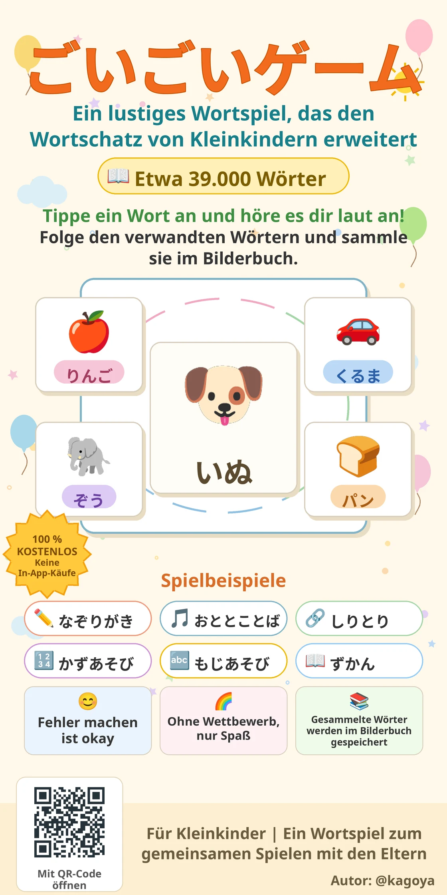

# ごいごいゲーム

**In anderen Sprachen lesen:** [日本語](README.md) | [やさしい日本語](README.ja-easy.md) | [English](README.en.md) | [简体中文](README.zh-Hans.md) | [繁體中文](README.zh-Hant.md) | [Português](README.pt.md) | [Español](README.es.md) | [Tiếng Việt](README.vi.md) | [ภาษาไทย](README.th.md) | [한국어](README.ko.md) | [Français](README.fr.md) | **Deutsch** | [Italiano](README.it.md) | [Bahasa Indonesia](README.id.md)

Ein Wortspiel für Kleinkinder, das im Browser gespielt wird und spielerisch den Wortschatz erweitert. **Komplett kostenlos – keine Gebühren.**

Aktuelle Version: **3.3**

**▶ Spielen: https://kagoya.github.io/goigoi/**

## So wird gespielt

- Beim Start öffnet sich der Startbildschirm, und die Spielkarten werden angezeigt
- Tippt man auf eine Wortkarte, wird das Wort vorgelesen
- Bei 「れんそう」 erscheinen Wörter, die mit dem gewählten Wort zu tun haben, rundherum, und indem man ihnen folgt, entdeckt man neue Wörter
- Gefundene Wörter werden im ずかん gesammelt (egal, in welchem Spiel man sie gefunden hat)

## Merkmale

- **Etwa 39.000 Wörter** enthalten (das ずかん hat zwei Ebenen: 11 große Kategorien und 200 kleine Kategorien)
- 18 Spiele auf dem Startbildschirm (れんそう, ききとりクイズ, なぞりがき, おととことば, ことばたんけん, もじあそび, ごじゅうおん ならべ, しりとり, かずあそび, はんたい言葉, てびょうし, とけいあそび, おまかせコース, おきにいりだけ, おはなばたけ, 冒険マップ, おやすみ振り返り, どっちがすき？). In den Anfangseinstellungen sind 6 eingeschaltet (れんそう, しりとり, もじあそび, おととことば, なぞりがき, ごじゅうおん ならべ), und jedes kann in den Einstellungen ein- oder ausgeschaltet werden
- 「もじあそび」 besteht aus zwei Spielen: 「ことば あなうめ」 und 「ことば みっけ」. 「ごじゅうおん ならべ」 ist ein eigenes Spiel: Man wählt eine Reihe aus der Gojuuon-Tabelle und ordnet die Zeichen. Ist eine Reihe vollständig, tippt man auf ein Zeichen und sieht eine Wortkarte mit diesem Zeichen
- Auch wenn man im Quiz etwas falsch macht, gilt das nie als Misserfolg: Die richtige Antwort wird gemeinsam überprüft und das Kind wird gelobt. Es gibt keinen Wettbewerb
- Die Größe des Wortschatzes kann aus 1.000 / 5.000 / 25.000 / alle gewählt werden (gefiltert nach einer 8-stufigen Bewertung, wie häufig ein Wort verwendet wird; gilt für alle Funktionen)
- Der Nachtmodus kann in den Einstellungen gewählt werden: „Tag / Nacht / automatisch nach Uhrzeit (18–6 Uhr)“. Er richtet sich nicht nach dem Dunkelmodus des Geräts
- Der Schalter für Ton an/aus ist ein gemeinsamer Schalter oben auf dem Bildschirm (bei おととことば und ききとりクイズ kann er nicht ausgeschaltet werden)
- Insgesamt 33 Arten von Stempeln (3 für Vervollständigung, 9 „zum ersten Mal“, 5 Meilensteine für die Anzahl gesammelter Wörter, 11 Erfolge, 5 für die Gesamtzahl der Spieltage). Man kann sie als runde Stempel im 「きろく」 für Kinder ansehen, das vom ずかん aus geöffnet wird
- Im ずかん zeigt jedes Wort mit einem „×N“-Abzeichen, wie oft mit ihm gespielt wurde. In der Kartenansicht erhält ein Wort ab 5 Mal einen silbernen Rand und ab 10 Mal einen goldenen Rand und eine 👑. Im 「きろく」 für Kinder stehen die am häufigsten gespielten Wörter als 「たくさん あそんだ ことば」, und die Anzahl steht auch im 保護者レポート und auf gedruckten Wortkarten
- Das ずかん kann vom Kind selbst zwischen Listenansicht und Kartenansicht mit großen Bildern umgeschaltet werden
- Wörter mit gleicher Lesung, aber unterschiedlicher Bedeutung (zum Beispiel はな = 花 „Blume“ und 鼻 „Nase“; たこ = タコ „Tintenfisch“ und 凧 „Drachen“) werden durch Bild und Kanji unterschieden und im ずかん getrennt gesammelt
- Das Bild eines Wortes kann in den Einstellungen unter 「言葉の絵を変える」 durch ein Foto ersetzt werden (das Foto wird automatisch verkleinert und gespeichert; es ist in Sicherungen enthalten und kann auf den Standard zurückgesetzt werden)
- Die Bewertung von なぞりがき kann in den Einstellungen einzeln eingestellt werden: Strichzahl, Strichfolge, Richtung, Form und exakte Form (auch über die Stufen 1–5 wählbar; die Anfangseinstellung entspricht Stufe 4)
- Die Erklärungen auf der Seite „Einstellungen“ können in 14 Sprachen gewählt werden (Japanisch, einfaches Japanisch mit Furigana, English, vereinfachtes Chinesisch, traditionelles Chinesisch, Português, Español, Vietnamesisch, Thailändisch, Koreanisch, Français, Deutsch, Italiano, Bahasa Indonesia). Die Begriffe und Wörter im Spiel bleiben auf Japanisch
- Profile für Geschwister, für bis zu 3 Kinder. Es gibt außerdem den 保護者レポート, das 「きろく」 und eine Sicherung der Aufzeichnungen

## Materialien für Erwachsene

- [Katalog für Erwachsene (PDF, auf Japanisch)](docs/goigoi-game-catalog.pdf) — ein 4-seitiges Dokument mit einer Übersicht der Funktionen, der Einstellungen und Hinweisen zur Nutzung

## Zur Funktionsweise

- Läuft nur mit den Standardfunktionen des Browsers, ohne externe Dienste oder kostenpflichtige KI
- Die Spielaufzeichnungen werden nur in Ihrem Browser gespeichert und niemals an einen Server gesendet
- Das Vorlesen und die Spracherkennung nutzen die Funktionen des Browsers (die Aussprache bei まねっこ funktioniert in Chrome / Edge. Die verfügbaren Stimmen hängen vom Gerät ab)
- Emoji, die das Gerät nicht anzeigen kann, werden automatisch durch das Emoji der Kategorie ersetzt

## Zu den verwendeten Materialien

- Daten zur Strichfolge: KanjiVG © Ulrich Apel (CC BY-SA 3.0)
- Klänge für 「おととことば」: Es werden CC0-Klangmaterialien verwendet. Die Quellen finden Sie in [assets/sounds/CREDITS.md](assets/sounds/CREDITS.md)

## Keine Gewährleistung

Dieses Spiel wird ohne Gewährleistung bereitgestellt. Es garantiert weder den Betrieb noch die Speicherung der Aufzeichnungen, und der Autor haftet nicht für Probleme oder Schäden, die aus der Nutzung entstehen. Die Nutzung erfolgt auf eigene Verantwortung.

## Lizenz

Veröffentlicht unter CC BY 4.0 (Creative Commons Namensnennung 4.0 International). Mit Namensnennung dürfen Sie es kopieren, verändern und weiterverbreiten. Einzelheiten finden Sie in [LICENSE](LICENSE). Die Daten zur Strichfolge (KanjiVG) stehen unter CC BY-SA 3.0.

Autor: @kagoya
