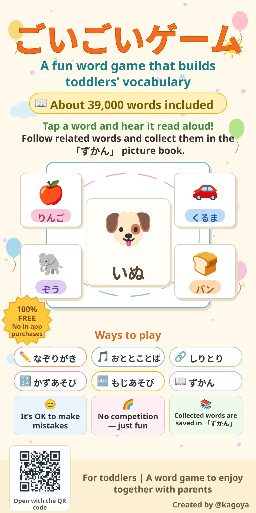

# ごいごいゲーム

**Read in other languages:** [日本語](README.md) | [やさしい日本語](README.ja-easy.md) | **English** | [简体中文](README.zh-Hans.md) | [繁體中文](README.zh-Hant.md) | [Português](README.pt.md) | [Español](README.es.md) | [Tiếng Việt](README.vi.md) | [ภาษาไทย](README.th.md) | [한국어](README.ko.md) | [Français](README.fr.md) | [Deutsch](README.de.md) | [Italiano](README.it.md) | [Bahasa Indonesia](README.id.md)

A word game for toddlers to enjoy growing their vocabulary, playable in a web browser. **Completely free — no charges.**

Current version: **3.6**

**▶ Play: https://kagoya.github.io/goigoi/**

## How to play

- When you start, a home screen opens with cards for each activity
- Tap a word card and the word is read aloud
- In 「れんそう」, words related to the one you picked appear around it, so following them leads you to new words
- Words you meet are collected in the ずかん, no matter which activity you found them in

## Features

- About **39,000 words** included (the ずかん has two levels: 11 large categories and 200 small categories)
- 19 activities on the home screen (れんそう, ききとりクイズ, なぞりがき, おととことば, ことばたんけん, もじあそび, ごじゅうおん ならべ, しりとり, かずあそび, はんたい言葉, てびょうし, とけいあそび, おまかせコース, おきにいりだけ, おはなばたけ, 冒険マップ, おやすみ振り返り, どっちがすき？, なあに？). Six are on in the initial settings (れんそう, しりとり, もじあそび, おととことば, なぞりがき, ごじゅうおん ならべ), and each can be turned on or off in Settings
- 「もじあそび」 consists of two games: 「ことば あなうめ」 and 「ことば みっけ」. 「ごじゅうおん ならべ」 is a separate activity: pick a row from the gojuuon chart and arrange its characters. After completing a row, choose a character to see a word card containing that character
- Even if you get a quiz question wrong, it is never treated as a failure — you check the right answer together and get praised. There is no competition
- Vocabulary size can be chosen from 500 / 1,000 / 2,000 / 4,000 / 8,000 / 16,000 / all (filtered by an 8-level rating of how commonly each word is used; applies to all features)
- The word ratings have been reviewed. With reference to public data such as the textbook corpus and BCCWJ of the National Institute for Japanese Language and Linguistics (NINJAL), the ratings have been adjusted so that basic words (such as する・いる・ある) are included in the 1,000-word range
- Night mode can be chosen in Settings: "day / night / automatic by time (18:00–6:00)". It does not follow your device's dark mode
- The sound on/off switch is a shared switch at the top of the screen (it cannot be turned off in おととことば or ききとりクイズ)
- 33 kinds of stamps in total (3 completion stamps, 9 "first time" stamps, 5 word-count milestone stamps, 11 achievement stamps, 5 total-days-played stamps). You can view them as round stamps in the children's 「きろく」, opened from the ずかん
- In the ずかん, each word shows how many times it has been played with, as a "×N" badge. In the card view, a word played with 5 or more times gets a silver border, and 10 or more times a gold border and a 👑. The children's 「きろく」 lines up the most-played words as 「たくさん あそんだ ことば」, and the count is also included in the 保護者レポート and in printed word cards
- The ずかん can be switched between a list view and a card view with big pictures, by the child
- Words with the same reading but different meanings (for example はな = 花 "flower" and 鼻 "nose"; たこ = タコ "octopus" and 凧 "kite") are distinguished by their pictures and kanji, and are collected separately in the ずかん
- The picture for a word can be replaced with a photo from Settings, in 「言葉の絵を変える」 (the photo is automatically reduced in size and saved; it is included in backups and can be reset to the default)
- The なぞりがき tracing checks can be set individually in Settings: stroke count, stroke order, direction, shape, and exact shape (levels 1–5 can also be chosen; the default is equivalent to level 4)
- The explanations on the Settings page are available in 14 languages (Japanese, Easy Japanese with furigana, English, Simplified Chinese, Traditional Chinese, Portuguese, Spanish, Vietnamese, Thai, Korean, French, German, Italian, Indonesian). In-game terms and words remain in Japanese
- Sibling profiles for up to 3 children. There is also a 保護者レポート, the 「きろく」, and backup of records
- 「なあに？」 is an activity where the child looks at a picture and says the word out loud. A grown-up listening nearby taps the 「いえたね」 button to record that the word was said (it is off in the initial settings)
- 「おはなばたけ」 is a scene that grows with the number of words collected: seeds → sprouts → young leaves → flowers → trees. More insects join along the way, and a rainbow appears when it is in full bloom
- The 保護者レポート also shows each word's "depth of encounter" (であいの深さ) in stages — であった (met) / えらべた (could pick it) / しっかり えらべた (could pick it in different activities or on different days) / こえに だせた (could say it out loud) — with counts and lists for each stage. This is only a guide based on play records, not a judgment of the child's understanding
- In Settings, 「集めた言葉の管理」 lets a grown-up delete collected words one at a time, with a confirmation, for each profile (words cannot be deleted from the ずかん itself)

## Materials for adults

- [Catalog for adults (PDF, in Japanese)](docs/goigoi-game-catalog.pdf) — a 4-page document listing the features, the settings, and notes on use

## How it works

- It runs using only standard browser features, with no external services or paid AI
- Play records are saved only in your browser and are never sent to a server
- Speech (reading aloud) and speech recognition use your browser's features (まねっこ pronunciation works in Chrome / Edge. The voices available depend on your device)
- Emoji that your device cannot display are automatically replaced with the category's emoji

## About the materials used

- Stroke order data: KanjiVG © Ulrich Apel (CC BY-SA 3.0)
- Sounds for 「おととことば」: CC0 sound materials are used. See [assets/sounds/CREDITS.md](assets/sounds/CREDITS.md) for the sources

## No warranty

This game is provided without warranty. It does not guarantee operation or the saving of records, and the author is not responsible for any problems or damage arising from its use. Please use it at your own responsibility.

## License

Published under CC BY 4.0 (Creative Commons Attribution 4.0 International). With attribution, you may copy, modify, and redistribute it. See [LICENSE](LICENSE) for details. The stroke order data (KanjiVG) is CC BY-SA 3.0.

Author: @kagoya
