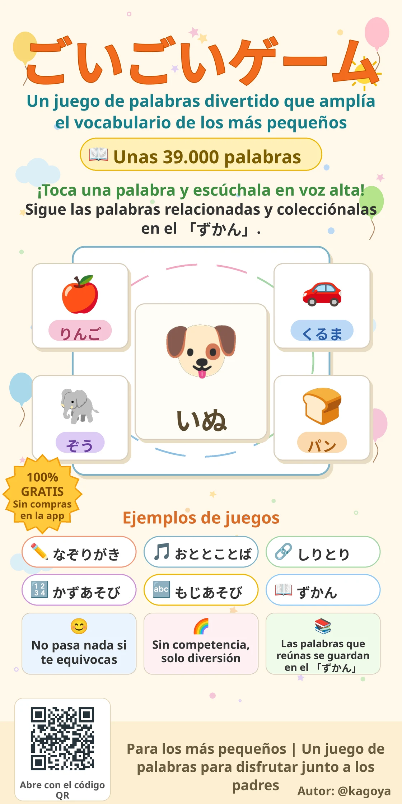

# ごいごいゲーム

**Leer en otros idiomas:** [日本語](README.md) | [やさしい日本語](README.ja-easy.md) | [English](README.en.md) | [简体中文](README.zh-Hans.md) | [繁體中文](README.zh-Hant.md) | [Português](README.pt.md) | **Español** | [Tiếng Việt](README.vi.md) | [ภาษาไทย](README.th.md) | [한국어](README.ko.md) | [Français](README.fr.md) | [Deutsch](README.de.md) | [Italiano](README.it.md) | [Bahasa Indonesia](README.id.md)

Un juego de palabras para que los niños pequeños amplíen su vocabulario jugando, disponible en el navegador. **Completamente gratis, sin cargos.**

Versión actual: **3.7**

**▶ Jugar: https://kagoya.github.io/goigoi/**

## Cómo jugar

- Al iniciar, se abre la pantalla de inicio con las tarjetas de cada juego en fila
- Al tocar una tarjeta de palabra, la palabra se lee en voz alta
- En 「れんそう」, las palabras relacionadas con la elegida aparecen alrededor, y siguiéndolas encontrarás palabras nuevas
- Las palabras que encuentres se coleccionan en el ずかん (en cualquier juego en el que las encuentres)

## Características

- **Unas 39.000 palabras** incluidas (el ずかん tiene dos niveles: 11 categorías grandes y 200 categorías pequeñas)
- 19 juegos en la pantalla de inicio (れんそう, ききとりクイズ, なぞりがき, おととことば, ことばたんけん, もじあそび, ごじゅうおん ならべ, しりとり, かずあそび, はんたい言葉, てびょうし, とけいあそび, おまかせコース, おきにいりだけ, おはなばたけ, 冒険マップ, おやすみ振り返り, どっちがすき？, なあに？). En la configuración inicial hay seis activados (れんそう, しりとり, もじあそび, おととことば, なぞりがき, ごじゅうおん ならべ), y cada uno se puede activar o desactivar en Ajustes
- 「もじあそび」 está formado por dos juegos: 「ことば あなうめ」 y 「ことば みっけ」. 「ごじゅうおん ならべ」 es un juego independiente: eliges una fila de la tabla gojuuon y ordenas sus letras. Al completar una fila, toca una letra para ver una tarjeta de una palabra que contiene esa letra
- Aunque te equivoques en el cuestionario, no se trata como un fracaso: la respuesta correcta se comprueba en conjunto y se elogia al niño. No hay competencia
- El tamaño del vocabulario se puede elegir entre 500 / 1.000 / 2.000 / 4.000 / 8.000 / 16.000 / todo (filtrado por una clasificación de 8 niveles según la frecuencia de uso; se aplica a todas las funciones)
- La clasificación de las palabras ha sido revisada. Con referencia a datos públicos, como el corpus de libros de texto y el BCCWJ del Instituto Nacional de la Lengua Japonesa (NINJAL), se han realizado ajustes para que palabras básicas (como する・いる・ある) estén incluidas en el rango de 1.000 palabras
- El modo nocturno se puede elegir en Ajustes: «día / noche / automático según la hora (18:00–6:00)». No sigue el modo oscuro del dispositivo
- El interruptor de sonido activado/desactivado es común, en la parte superior de la pantalla (no se puede desactivar en おととことば ni en ききとりクイズ)
- 33 tipos de sellos en total (3 de finalización, 9 de «primera vez», 5 de hitos de palabras coleccionadas, 11 de logros, 5 de días totales jugados). Se pueden ver con forma de sello redondo en el 「きろく」 infantil, que se abre desde el ずかん
- En el ずかん, cada palabra muestra cuántas veces se ha jugado con ella, con una insignia «×N». En la vista de tarjetas, una palabra jugada 5 veces o más recibe un borde plateado, y 10 veces o más, un borde dorado y un 👑. El 「きろく」 infantil reúne las palabras más jugadas como «たくさん あそんだ ことば», y el recuento también se incluye en el 保護者レポート y en las tarjetas de palabras impresas
- El ずかん puede cambiarse entre la vista de lista y la vista de tarjetas con imágenes grandes, por el propio niño
- Las palabras con la misma lectura pero significados diferentes (por ejemplo, はな = 花 «flor» y 鼻 «nariz»; たこ = タコ «pulpo» y 凧 «cometa») se distinguen por la imagen y el kanji, y se recogen por separado en el ずかん
- La imagen de una palabra puede cambiarse por una foto en Ajustes, en 「言葉の絵を変える」 (la foto se reduce automáticamente y se guarda; se incluye en la copia de seguridad y puede restablecerse al valor predeterminado)
- La evaluación de なぞりがき puede ajustarse en Ajustes, elemento por elemento: número de trazos, orden de los trazos, dirección, forma y forma exacta (también se puede elegir por niveles 1–5; el valor predeterminado equivale al nivel 4)
- Las explicaciones de la página de Ajustes están disponibles en 14 idiomas (japonés, japonés fácil con furigana, English, chino simplificado, chino tradicional, Português, Español, vietnamita, tailandés, coreano, francés, alemán, italiano, indonesio). Los términos y las palabras del juego permanecen en japonés
- La pantalla de Ajustes también tiene un botón que abre el catálogo para adultos (PDF) en el idioma seleccionado
- Perfiles para hasta 3 hermanos. También hay un 保護者レポート, el 「きろく」 y copia de seguridad de los registros
- 「なあに？」 es un juego en el que el niño mira la imagen y dice la palabra en voz alta. Un adulto que esté escuchando cerca toca el botón «いえたね» para registrar que la palabra fue dicha (está desactivado en la configuración inicial) También hay una visualización de la respuesta que solo pueden abrir los adultos y una guía para valorar (por ejemplo, vale si el primer sonido coincide)
- 「おはなばたけ» es un paisaje que crece según la cantidad de palabras recogidas: semillas → brotes → hojas jóvenes → flores → árboles. Cada vez aparecen más insectos, y aparece un arcoíris cuando está en plena floración
- El 保護者レポート también muestra la «profundidad del encuentro» (であいの深さ) de cada palabra por etapas: であった (la conoció) / えらべた (pudo elegirla) / しっかり えらべた (pudo elegirla en juegos distintos o en días distintos) / こえに だせた (pudo decirla en voz alta), con cantidades y listas por etapa. Es solo una guía a partir de los registros de juego, no un juicio sobre la comprensión
- En Ajustes, «集めた言葉の管理» permite que un adulto elimine las palabras recogidas una a una, con confirmación, para cada perfil (no se pueden eliminar desde el ずかん)

## Material para adultos

- [Catálogo para adultos (PDF, en japonés)](docs/goigoi-game-catalog.pdf) — un documento de 4 páginas con la lista de funciones, los ajustes y notas sobre el uso

## Sobre el funcionamiento

- Funciona usando solo las funciones estándar del navegador, sin servicios externos ni IA de pago
- Los registros de juego se guardan solo en tu navegador y nunca se envían a un servidor
- La lectura en voz alta y el reconocimiento de voz usan las funciones del navegador (la pronunciación en まねっこ funciona en Chrome / Edge. Los tipos de voz disponibles dependen del dispositivo)
- Los emojis que el dispositivo no puede mostrar se sustituyen automáticamente por el emoji de la categoría

## Sobre los materiales utilizados

- Datos del orden de los trazos: KanjiVG © Ulrich Apel (CC BY-SA 3.0)
- Sonidos de 「おととことば」: se utilizan materiales de sonido CC0. Consulta las fuentes en [assets/sounds/CREDITS.md](assets/sounds/CREDITS.md)

## Sin garantía

Este juego se proporciona sin garantía. No se garantiza su funcionamiento ni el guardado de los registros, y el autor no se hace responsable de los problemas o daños derivados de su uso. Úsalo bajo tu propia responsabilidad.

## Licencia

Publicado bajo CC BY 4.0 (Creative Commons Atribución 4.0 Internacional). Con atribución al autor, puedes copiarlo, modificarlo y redistribuirlo. Consulta los detalles en [LICENSE](LICENSE). Los datos del orden de los trazos (KanjiVG) son CC BY-SA 3.0.

Autor: @kagoya
