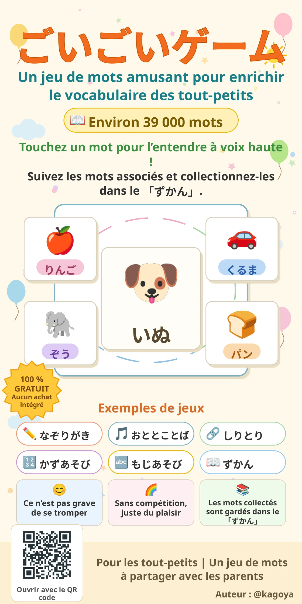

# ごいごいゲーム

**Lire dans d'autres langues :** [日本語](README.md) | [やさしい日本語](README.ja-easy.md) | [English](README.en.md) | [简体中文](README.zh-Hans.md) | [繁體中文](README.zh-Hant.md) | [Português](README.pt.md) | [Español](README.es.md) | [Tiếng Việt](README.vi.md) | [ภาษาไทย](README.th.md) | [한국어](README.ko.md) | **Français** | [Deutsch](README.de.md) | [Italiano](README.it.md) | [Bahasa Indonesia](README.id.md)

Un jeu de mots pour les tout-petits, à jouer dans le navigateur, pour enrichir leur vocabulaire en s'amusant. **Entièrement gratuit, sans aucun frais.**

Version actuelle : **3.6**

**▶ Jouer : https://kagoya.github.io/goigoi/**

## Comment jouer

- Au démarrage, l'écran d'accueil s'ouvre et les cartes des jeux s'affichent
- En touchant une carte de mot, le mot est lu à voix haute
- Dans 「れんそう」, les mots liés au mot choisi apparaissent autour, et en les suivant on découvre de nouveaux mots
- Les mots rencontrés s'accumulent dans le ずかん (quel que soit le jeu dans lequel on les a trouvés)

## Caractéristiques

- **Environ 39 000 mots** inclus (le ずかん a deux niveaux : 11 grandes catégories et 200 petites catégories)
- 19 jeux sur l'écran d'accueil (れんそう, ききとりクイズ, なぞりがき, おととことば, ことばたんけん, もじあそび, ごじゅうおん ならべ, しりとり, かずあそび, はんたい言葉, てびょうし, とけいあそび, おまかせコース, おきにいりだけ, おはなばたけ, 冒険マップ, おやすみ振り返り, どっちがすき？, なあに？). Dans les réglages initiaux, 6 sont activés (れんそう, しりとり, もじあそび, おととことば, なぞりがき, ごじゅうおん ならべ), et chacun peut être activé ou désactivé dans les Réglages
- 「もじあそび」 comprend deux jeux : 「ことば あなうめ」 et 「ことば みっけ」. 「ごじゅうおん ならべ」 est un jeu indépendant : on choisit une ligne du tableau gojuuon et on y range les caractères. Une fois la ligne complétée, touchez un caractère pour voir une carte d'un mot contenant ce caractère
- Même en cas d'erreur au quiz, ce n'est jamais un échec : on vérifie la bonne réponse ensemble et l'enfant est félicité. Il n'y a aucune compétition
- La taille du vocabulaire peut être choisie parmi 500 / 1 000 / 2 000 / 4 000 / 8 000 / 16 000 / tout (filtrage selon une évaluation en 8 niveaux de la fréquence d'usage des mots ; s'applique à toutes les fonctions)
- L'évaluation des mots a été révisée. En référence à des données publiques telles que le corpus de manuels scolaires et le BCCWJ de l'Institut national de la langue japonaise (NINJAL), des ajustements ont été effectués pour que des mots de base (comme する・いる・ある) soient inclus dans la plage de 1 000 mots
- Le mode nuit peut être choisi dans les Réglages : « jour / nuit / automatique selon l'heure (18 h – 6 h) ». Il ne suit pas le mode sombre de l'appareil
- L'interrupteur du son est un interrupteur commun en haut de l'écran (il ne peut pas être désactivé dans おととことば et ききとりクイズ)
- 33 types de tampons au total (3 de complétion, 9 « première fois », 5 de paliers de nombre de mots recueillis, 11 de réussite, 5 de jours de jeu cumulés). On peut les admirer sous forme de tampons ronds dans le 「きろく」 pour enfants, ouvert depuis le ずかん
- Dans le ずかん, chaque mot affiche le nombre de fois où l'on a joué avec lui, sous forme de badge « ×N ». Dans la vue en cartes, un mot joué 5 fois ou plus reçoit une bordure argentée, et 10 fois ou plus, une bordure dorée et un 👑. Le 「きろく」 pour enfants présente les mots les plus joués sous le titre « たくさん あそんだ ことば », et le nombre figure aussi dans le 保護者レポート et sur les cartes de mots imprimées
- L'enfant peut lui-même basculer le ずかん entre l'affichage en liste et l'affichage en cartes avec de grandes images
- Les mots qui se lisent de la même façon mais ont des sens différents (par exemple はな = 花 « fleur » et 鼻 « nez » ; たこ = タコ « poulpe » et 凧 « cerf-volant ») se distinguent par l'image et le kanji, et sont recueillis séparément dans le ずかん
- L'image d'un mot peut être remplacée par une photo depuis les Réglages, dans 「言葉の絵を変える」 (la photo est automatiquement réduite et enregistrée ; elle est incluse dans les sauvegardes et peut être réinitialisée)
- L'évaluation de なぞりがき peut être réglée individuellement dans les Réglages : nombre de traits, ordre des traits, direction, forme et forme exacte (choix possible aussi par les niveaux 1 à 5 ; le réglage initial équivaut au niveau 4)
- Les explications de la page des Réglages peuvent être choisies parmi 14 langues (japonais, japonais facile avec furigana, English, chinois simplifié, chinois traditionnel, Português, Español, vietnamien, thaï, coréen, Français, Deutsch, Italiano, Bahasa Indonesia). Les termes et les mots du jeu restent en japonais
- Profils pour frères et sœurs, jusqu'à 3 enfants. Il y a aussi le 保護者レポート, le 「きろく」 et la sauvegarde des données
- 「なあに？」 est un jeu où l'enfant regarde une image et dit le mot à voix haute. Un adulte qui écoute à côté appuie sur le bouton 「いえたね」 pour enregistrer que le mot a été dit (il est désactivé dans les réglages initiaux)
- 「おはなばたけ」 est un paysage qui grandit avec le nombre de mots collectés : graines → pousses → jeunes feuilles → fleurs → arbres. Les insectes sont de plus en plus nombreux, et un arc-en-ciel apparaît à la pleine floraison
- Le 保護者レポート affiche aussi, pour chaque mot, sa « profondeur de rencontre » (であいの深さ) par étapes — であった (rencontré) / えらべた (a su le choisir) / しっかり えらべた (a su le choisir dans d'autres jeux ou d'autres jours) / こえに だせた (a su le dire à voix haute) — avec les nombres et les listes par étape. Ce n'est qu'un repère tiré des enregistrements de jeu, pas un jugement sur la compréhension
- Dans les Réglages, 「集めた言葉の管理」 permet à un adulte de supprimer les mots collectés un par un, avec confirmation, pour chaque profil (on ne peut pas les supprimer depuis le ずかん)

## Documents pour les adultes

- [Catalogue pour adultes (PDF, en japonais)](docs/goigoi-game-catalog.pdf) — un document de 4 pages qui résume la liste des fonctions, les réglages et les précautions d'utilisation

## À propos du fonctionnement

- Fonctionne uniquement avec les fonctions standard du navigateur, sans services externes ni IA payante
- Les données de jeu sont enregistrées uniquement dans votre navigateur et ne sont jamais envoyées à un serveur
- La lecture à voix haute et la reconnaissance vocale utilisent les fonctions du navigateur (la prononciation de まねっこ fonctionne sous Chrome / Edge. Les voix disponibles dépendent de l'appareil)
- Les emoji que l'appareil ne peut pas afficher sont automatiquement remplacés par l'emoji de la catégorie

## À propos des matériaux utilisés

- Données d'ordre des traits : KanjiVG © Ulrich Apel (CC BY-SA 3.0)
- Sons de 「おととことば」 : des matériaux sonores CC0 sont utilisés. Voir les sources dans [assets/sounds/CREDITS.md](assets/sounds/CREDITS.md)

## Absence de garantie

Ce jeu est fourni sans garantie. Il ne garantit ni le fonctionnement ni la sauvegarde des données, et l'auteur n'est pas responsable des problèmes ou dommages résultant de son utilisation. Utilisation à vos propres risques.

## Licence

Publié sous CC BY 4.0 (Creative Commons Attribution 4.0 International). Avec mention de l'auteur, vous pouvez le copier, le modifier et le redistribuer. Voir [LICENSE](LICENSE) pour les détails. Les données d'ordre des traits (KanjiVG) sont sous CC BY-SA 3.0.

Auteur : @kagoya
