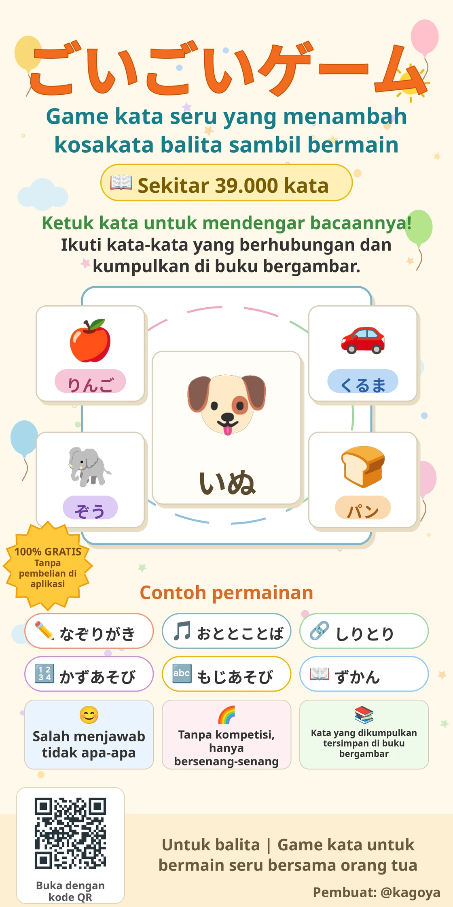

# ごいごいゲーム

**Baca dalam bahasa lain:** [日本語](README.md) | [やさしい日本語](README.ja-easy.md) | [English](README.en.md) | [简体中文](README.zh-Hans.md) | [繁體中文](README.zh-Hant.md) | [Português](README.pt.md) | [Español](README.es.md) | [Tiếng Việt](README.vi.md) | [ภาษาไทย](README.th.md) | [한국어](README.ko.md) | [Français](README.fr.md) | [Deutsch](README.de.md) | [Italiano](README.it.md) | **Bahasa Indonesia**

Permainan kata untuk anak usia dini yang dapat dimainkan di peramban, untuk menambah kosakata sambil bermain. **Sepenuhnya gratis, tanpa biaya.**

Versi saat ini: **3.5**

**▶ Main: https://kagoya.github.io/goigoi/**

## Cara bermain

- Saat dimulai, layar beranda terbuka dan kartu-kartu permainan berjajar
- Jika kartu kata disentuh, kata tersebut akan dibacakan dengan suara
- Di 「れんそう」, kata-kata yang berkaitan dengan kata yang dipilih muncul di sekelilingnya, dan dengan mengikutinya Anda dapat menemukan kata-kata baru
- Kata-kata yang ditemui akan terkumpul di ずかん (di permainan mana pun kata itu ditemukan)

## Fitur

- Berisi **sekitar 39.000 kata** (ずかん memiliki dua tingkat: 11 kategori besar dan 200 kategori kecil)
- 18 permainan di layar beranda (れんそう, ききとりクイズ, なぞりがき, おととことば, ことばたんけん, もじあそび, ごじゅうおん ならべ, しりとり, かずあそび, はんたい言葉, てびょうし, とけいあそび, おまかせコース, おきにいりだけ, おはなばたけ, 冒険マップ, おやすみ振り返り, どっちがすき？). Pada pengaturan awal, 6 permainan aktif (れんそう, しりとり, もじあそび, おととことば, なぞりがき, ごじゅうおん ならべ), dan masing-masing dapat diaktifkan atau dinonaktifkan di Pengaturan
- 「もじあそび」 terdiri dari dua permainan: 「ことば あなうめ」 dan 「ことば みっけ」. 「ごじゅうおん ならべ」 adalah permainan tersendiri: pilih satu baris dari tabel gojuuon dan susun huruf-hurufnya. Setelah satu baris lengkap, ketuk satu huruf untuk melihat kartu kata yang mengandung huruf tersebut
- Meskipun salah menjawab kuis, itu tidak pernah dianggap sebagai kegagalan: jawaban yang benar diperiksa bersama dan anak dipuji. Tidak ada persaingan
- Ukuran kosakata dapat dipilih dari 500 / 1.000 / 2.000 / 4.000 / 8.000 / 16.000 / semua (disaring dengan peringkat 8 tingkat berdasarkan seberapa sering kata digunakan; berlaku untuk semua fitur)
- Peringkat kata telah ditinjau kembali. Dengan mengacu pada data publik seperti korpus buku teks dan BCCWJ dari Institut Nasional Bahasa Jepang (NINJAL), penyesuaian dilakukan agar kata-kata dasar (seperti する・いる・ある) termasuk dalam rentang 1.000 kata
- Mode malam dapat dipilih di Pengaturan: "siang / malam / otomatis menurut waktu (18.00–06.00)". Tidak mengikuti mode gelap perangkat
- Sakelar nyala/mati suara adalah sakelar bersama di bagian atas layar (tidak dapat dimatikan di おととことば dan ききとりクイズ)
- Total 33 jenis stempel (3 stempel penyelesaian, 9 stempel "pertama kali", 5 stempel pencapaian jumlah kata yang dikumpulkan, 11 stempel prestasi, 5 stempel total hari bermain). Dapat dilihat dalam bentuk stempel bulat di 「きろく」 untuk anak, yang dibuka dari ずかん
- Di ずかん, setiap kata menampilkan berapa kali kata itu dimainkan, dengan lencana "×N". Dalam tampilan kartu, kata yang dimainkan 5 kali atau lebih mendapat bingkai perak, dan 10 kali atau lebih mendapat bingkai emas dan 👑. 「きろく」 untuk anak menampilkan kata yang paling sering dimainkan sebagai 「たくさん あそんだ ことば」, dan jumlahnya juga tercantum di 保護者レポート dan kartu kata yang dicetak
- ずかん dapat dialihkan oleh anak sendiri antara tampilan daftar dan tampilan kartu dengan gambar besar
- Kata-kata dengan bacaan yang sama tetapi arti berbeda (misalnya はな = 花 "bunga" dan 鼻 "hidung"; たこ = タコ "gurita" dan 凧 "layang-layang") dibedakan dengan gambar dan kanji, dan dikumpulkan secara terpisah di ずかん
- Gambar suatu kata dapat diganti dengan foto dari Pengaturan, di 「言葉の絵を変える」 (foto otomatis diperkecil ukurannya dan disimpan; termasuk dalam cadangan dan dapat dikembalikan ke bawaan)
- Penilaian なぞりがき dapat diatur satu per satu di Pengaturan: jumlah goresan, urutan goresan, arah, bentuk, dan bentuk persis (dapat juga dipilih dengan level 1–5; pengaturan awal setara dengan level 4)
- Penjelasan di halaman Pengaturan dapat dipilih dari 14 bahasa (bahasa Jepang, bahasa Jepang mudah dengan furigana, English, bahasa Tionghoa sederhana, bahasa Tionghoa tradisional, Português, Español, bahasa Vietnam, bahasa Thai, bahasa Korea, Français, Deutsch, Italiano, Bahasa Indonesia). Istilah dan kata di dalam permainan tetap dalam bahasa Jepang
- Profil untuk saudara kandung, hingga 3 anak. Ada juga 保護者レポート, 「きろく」, dan cadangan catatan

## Materi untuk orang dewasa

- [Katalog untuk orang dewasa (PDF, dalam bahasa Jepang)](docs/goigoi-game-catalog.pdf) — dokumen 4 halaman yang merangkum daftar fitur, pengaturan, dan hal-hal yang perlu diperhatikan dalam penggunaan

## Tentang cara kerja

- Berjalan hanya dengan fitur standar peramban, tanpa layanan eksternal atau AI berbayar
- Catatan permainan hanya disimpan di peramban Anda dan tidak pernah dikirim ke server
- Pembacaan suara dan pengenalan suara menggunakan fitur peramban (pelafalan まねっこ berfungsi di Chrome / Edge. Jenis suara yang tersedia bergantung pada perangkat)
- Emoji yang tidak dapat ditampilkan oleh perangkat akan otomatis diganti dengan emoji kategorinya

## Tentang materi yang digunakan

- Data urutan goresan: KanjiVG © Ulrich Apel (CC BY-SA 3.0)
- Suara untuk 「おととことば」: menggunakan materi suara CC0. Lihat sumbernya di [assets/sounds/CREDITS.md](assets/sounds/CREDITS.md)

## Tanpa garansi

Permainan ini disediakan tanpa garansi. Tidak ada jaminan atas berfungsinya permainan maupun tersimpannya catatan, dan pembuat tidak bertanggung jawab atas masalah atau kerugian yang timbul dari penggunaan. Gunakan dengan tanggung jawab sendiri.

## Lisensi

Diterbitkan dengan CC BY 4.0 (Creative Commons Atribusi 4.0 Internasional). Dengan mencantumkan nama pembuat, Anda dapat menyalin, mengubah, dan menyebarkannya kembali. Lihat [LICENSE](LICENSE) untuk rinciannya. Data urutan goresan (KanjiVG) berada di bawah CC BY-SA 3.0.

Pembuat: @kagoya
