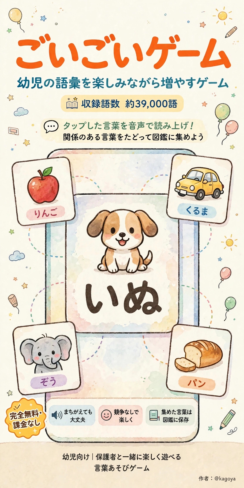

# ごいごいゲーム

**Leggi in altre lingue:** [日本語](README.md) | [やさしい日本語](README.ja-easy.md) | [English](README.en.md) | [简体中文](README.zh-Hans.md) | [繁體中文](README.zh-Hant.md) | [Português](README.pt.md) | [Español](README.es.md) | [Tiếng Việt](README.vi.md) | [ภาษาไทย](README.th.md) | [한국어](README.ko.md) | [Français](README.fr.md) | [Deutsch](README.de.md) | **Italiano** | [Bahasa Indonesia](README.id.md)

Un gioco di parole per bambini piccoli, giocabile nel browser, per arricchire il vocabolario divertendosi. **Completamente gratuito, senza costi.**

Versione attuale: **3.0**

**▶ Gioca: https://kagoya.github.io/goigoi/**

## Come si gioca

- All'avvio si apre la schermata iniziale e vengono mostrate le carte dei giochi
- Toccando una carta parola, la parola viene letta ad alta voce
- In 「れんそう」, intorno alla parola scelta appaiono parole collegate, e seguendole si incontrano parole nuove
- Le parole incontrate si accumulano nel ずかん (in qualunque gioco siano state trovate)

## Caratteristiche

- **Circa 39.000 parole** incluse (il ずかん ha due livelli: 11 categorie grandi e 200 categorie piccole)
- 17 giochi nella schermata iniziale (れんそう, ききとりクイズ, なぞりがき, おととことば, ことばたんけん, もじあそび, しりとり, かずあそび, はんたい言葉, てびょうし, とけいあそび, おまかせコース, おきにいりだけ, おはなばたけ, 冒険マップ, おやすみ振り返り, どっちがすき？). Nelle impostazioni iniziali ne sono attivi 5 (れんそう, しりとり, もじあそび, おととことば, なぞりがき), e ciascuno può essere attivato o disattivato nelle Impostazioni
- Anche se si sbaglia nel quiz, non è mai considerato un fallimento: si controlla insieme la risposta giusta e il bambino viene lodato. Non c'è competizione
- La dimensione del vocabolario può essere scelta tra 1.000 / 5.000 / 25.000 / tutto (filtrata con una valutazione in 8 livelli della frequenza d'uso delle parole; vale per tutte le funzioni)
- La modalità notte può essere scelta nelle Impostazioni: «giorno / notte / automatica in base all'orario (18:00–6:00)». Non segue la modalità scura del dispositivo
- L'interruttore di attivazione/disattivazione dell'audio è un interruttore comune nella parte superiore dello schermo (non può essere disattivato in おととことば e ききとりクイズ)
- 25 tipi di timbri in totale (3 di completamento, 8 «prima volta», 5 di traguardi sul numero di parole raccolte, 9 di successi). Si possono ammirare come timbri rotondi nel 「きろく」 per bambini, che si apre dal ずかん
- Il bambino può cambiare da solo il ずかん tra la visualizzazione a elenco e la visualizzazione a carte con immagini grandi
- L'immagine di una parola può essere sostituita con una foto dalle Impostazioni, in 「言葉の絵を変える」 (la foto viene ridotta automaticamente e salvata; è inclusa nei backup e può essere ripristinata al valore predefinito)
- La valutazione di なぞりがき può essere impostata singolarmente nelle Impostazioni: numero di tratti, ordine dei tratti, direzione, forma e forma esatta (si può scegliere anche con i livelli 1–5; l'impostazione iniziale corrisponde al livello 4)
- Le spiegazioni nella pagina delle Impostazioni possono essere scelte tra 14 lingue (giapponese, giapponese facile con furigana, English, cinese semplificato, cinese tradizionale, Português, Español, vietnamita, tailandese, coreano, Français, Deutsch, Italiano, Bahasa Indonesia). I termini e le parole del gioco restano in giapponese
- Profili per fratelli e sorelle, fino a 3 bambini. Ci sono anche il 保護者レポート, il 「きろく」 e il backup dei dati

## Materiali per gli adulti

- [Catalogo per adulti (PDF, in giapponese)](docs/goigoi-game-catalog.pdf) — un documento di 4 pagine con l'elenco delle funzioni, le impostazioni e le avvertenze per l'uso

## Informazioni sul funzionamento

- Funziona solo con le funzioni standard del browser, senza servizi esterni né IA a pagamento
- I dati di gioco vengono salvati solo nel tuo browser e non vengono mai inviati a un server
- La lettura ad alta voce e il riconoscimento vocale usano le funzioni del browser (la pronuncia di まねっこ funziona in Chrome / Edge. Le voci disponibili dipendono dal dispositivo)
- Le emoji che il dispositivo non può mostrare vengono sostituite automaticamente con l'emoji della categoria

## Informazioni sui materiali utilizzati

- Dati sull'ordine dei tratti: KanjiVG © Ulrich Apel (CC BY-SA 3.0)
- Suoni di 「おととことば」: vengono utilizzati materiali sonori CC0. Le fonti sono in [assets/sounds/CREDITS.md](assets/sounds/CREDITS.md)

## Nessuna garanzia

Questo gioco è fornito senza garanzia. Non garantisce il funzionamento né il salvataggio dei dati, e l'autore non è responsabile per problemi o danni derivanti dall'uso. L'utilizzo è a proprio rischio.

## Licenza

Pubblicato con CC BY 4.0 (Creative Commons Attribuzione 4.0 Internazionale). Con l'attribuzione all'autore, puoi copiarlo, modificarlo e ridistribuirlo. Vedi [LICENSE](LICENSE) per i dettagli. I dati sull'ordine dei tratti (KanjiVG) sono sotto CC BY-SA 3.0.

Autore: @kagoya
