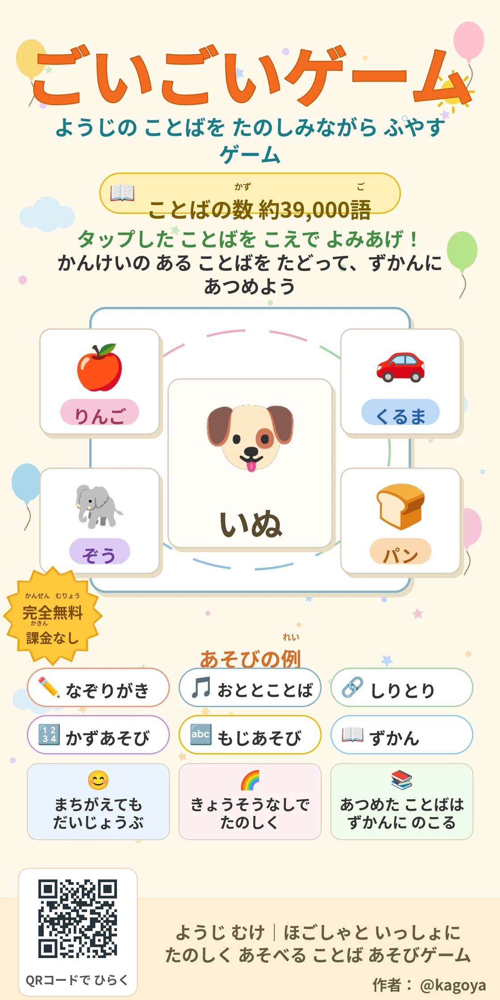

# ごいごいゲーム

**ほかの 言葉で 読む：** [日本語](README.md) | **やさしい日本語** | [English](README.en.md) | [简体中文](README.zh-Hans.md) | [繁體中文](README.zh-Hant.md) | [Português](README.pt.md) | [Español](README.es.md) | [Tiếng Việt](README.vi.md) | [ภาษาไทย](README.th.md) | [한국어](README.ko.md) | [Français](README.fr.md) | [Deutsch](README.de.md) | [Italiano](README.it.md) | [Bahasa Indonesia](README.id.md)

小さい 子どもが、楽しみながら 言葉を ふやすための、ブラウザで 遊べる 言葉の ゲームです。**お金は かかりません。**

いまの バージョン： **3.6**

**▶ 遊ぶ： https://kagoya.github.io/goigoi/**

## <ruby>遊<rt>あそ</rt></ruby>び<ruby>方<rt>かた</rt></ruby>

- ゲームを はじめると、ホーム画面が 開きます。遊びの カードが ならびます
- 言葉の カードを タップすると、声で 読んで くれます
- 「れんそう」では、えらんだ 言葉と つながりの ある 言葉が まわりに 出ます。たどって いくと、新しい 言葉に 出会えます
- 出会った 言葉は、ずかんに たまります（どの 遊びで 出会っても たまります）

## とくちょう

- 言葉は **39,000語くらい** あります（ずかんは、大きい 分けかたが 11、小さい 分けかたが 200の、2つの グループに なっています）
- ホームに ある 遊びは 19しゅるいです（れんそう、ききとりクイズ、なぞりがき、おととことば、ことばたんけん、もじあそび、ごじゅうおん ならべ、しりとり、かずあそび、はんたい言葉、てびょうし、とけいあそび、おまかせコース、おきにいりだけ、おはなばたけ、冒険マップ、おやすみ振り返り、どっちがすき？、なあに？）。はじめの 設定では 6つ（れんそう、しりとり、もじあそび、おととことば、なぞりがき、ごじゅうおん ならべ）が オンに なっています。設定で 1つずつ オン・オフ できます
- 「もじあそび」は、「ことば あなうめ」と「ことば みっけ」の 2つの 遊びです。「ごじゅうおん ならべ」では、五十音の 表から 行を えらんで、文字を ならべます。行が そろった 後で 文字を えらぶと、その 文字が 入った 言葉の カードが 出ます
- クイズで まちがえても、しっぱいには しません。正しい 答えを いっしょに 見て、ほめます。きょうそうは ありません
- 言葉の 数は、500／1,000／2,000／4,000／8,000／16,000／全部から えらべます（よく 使う 言葉を、8つの レベルに 分けて しぼります。全部の きのうに つながります）
- ことばの レーティングを 見直しました。国立国語研究所の 教科書コーパスや BCCWJなどの 公開データを もとに、1,000語の 中に、する・いる・ある のような よく 使う ことばが 入るように 調整しています
- ナイトモードは 設定で「ひる／よる／時間で 自動（18時〜次の 日の 6時）」から えらべます。使っている きかいの ダークモードには つながりません
- 音の オン・オフは、画面の 上に ある スイッチです（おととことば と ききとりクイズでは オフに できません）
- スタンプは 全部で 33しゅるいです（コンプリート 3しゅるい、「はじめて」の スタンプ 9しゅるい、あつめた 言葉の 数の スタンプ 5しゅるい、たっせいの スタンプ 11しゅるい、あそんだ 日の 数の スタンプ 5しゅるい）。ずかんから 開く、子ども用の「きろく」で、まるい スタンプの 形で 見ることが できます
- ずかんでは、言葉ごとに あそんだ 数が「×N」の バッジで 出ます。カードの 見せ方では、5回から ぎん色の ふち、10回から 金色の ふちと 👑が つきます。子ども用の「きろく」には、数の 多い「たくさん あそんだ ことば」が ならびます。保護者レポートと、ことばカードの いんさつにも 数が 入ります
- ずかんは、リストの 見せ方と、絵が 大きい カードの 見せ方を、子ども 自身が かえることが できます
- 同じ 読みでも いみの ちがう 言葉（たとえば「はな」🌸と「はな」👃、「たこ」🐙と「たこ」🪁）は、絵と 漢字で わけて 見せます。ずかんにも べつべつに あつまります
- 言葉の 絵は、設定の「言葉の絵を変える」から 写真に かえることが できます（写真は 自動で 小さく して、ほぞんします。バックアップにも 入ります。もとの 絵に もどすことも できます）
- なぞりがきの はんていは、設定で、画数・書き順・向き・形・正確な形を、1つずつ 設定できます（レベル1〜5でも えらべます。はじめの 設定は レベル4と だいたい 同じです）
- 設定ページの せつめいは、14の 言葉から えらべます（日本語、やさしい日本語（ふりがな付き）、English、简体中文、繁體中文、Português、Español、Tiếng Việt、ภาษาไทย、한국어、Français、Deutsch、Italiano、Bahasa Indonesia）。ゲームの 中の 名前や 言葉は、日本語のままです
- きょうだい用の プロフィールは 3人までです。保護者レポートや「きろく」が あります。きろくの バックアップも できます
- 「なあに？」は、絵を 見て 言葉を 声に 出す 遊びです。そばで 聞いている 大人が「いえたね」の ボタンを タップすると、きろくに 入ります（はじめの 設定では オフです）
- 「おはなばたけ」は、あつめた 言葉の 数に 合わせて、たね→め→わかば→花→木と 育っていく 花畑です。虫も 増えて、いっぱいに なると にじが かかります
- 保護者レポートには、言葉ごとの「であいの 深さ」（であった／えらべた／しっかり えらべた／こえに だせた）の だんかいの 数と いちらんも 出ます（分かったかどうかを 決めるものでは なく、遊びの きろくからの 目安です）
- 設定の「集めた言葉の管理」では、大人が プロフィールごとに、あつめた 言葉を 1つずつ 見てから 消すことが できます（ずかんからは 消せません）

## <ruby>大人<rt>おとな</rt></ruby>のための <ruby>資料<rt>しりょう</rt></ruby>

- [大人用カタログ（PDF）](docs/goigoi-game-catalog.pdf) ― きのうの リストや 設定、使うときの 注意を まとめた、4ページの しりょうです

## うごきについて

- 外の サービスや、お金の かかる AIは 使いません。ブラウザに ある きのうだけで うごきます
- 遊んだ きろくは、あなたの ブラウザの 中だけに ほぞんします。サーバーには 送りません
- 声で 読むことと、声を 聞き取ることは、ブラウザの きのうを 使います（まねっこの 発音は Chrome / Edge で うごきます。読む 声の しゅるいは、きかいに よって ちがいます）
- きかいで 出せない 絵文字は、その グループの 絵文字に 自動で かわります

## <ruby>使<rt>つか</rt></ruby>っている ものについて

- 書き順の データ： KanjiVG © Ulrich Apel（CC BY-SA 3.0）
- 「おととことば」の 音： CC0 の 音を 使っています。出どころは [assets/sounds/CREDITS.md](assets/sounds/CREDITS.md) を 見て ください

## <ruby>保証<rt>ほしょう</rt></ruby>は ありません

この ゲームは、ほしょうなしで ていきょうします。うごくことや、きろくが ほぞんできることを、ほしょうしません。使って 起きた 問題や そんがいについて、作った 人は せきにんを とりません。自分の せきにんで 使って ください。

## ライセンス

CC BY 4.0（クリエイティブ・コモンズ表示 4.0 国際ライセンス）で 公開しています。作った 人の 名前を 書けば、コピー・へんこう・さいはいふが できます。くわしくは [LICENSE](LICENSE) を 見て ください。書き順の データ（KanjiVG）は CC BY-SA 3.0 です。

作った人： @kagoya
