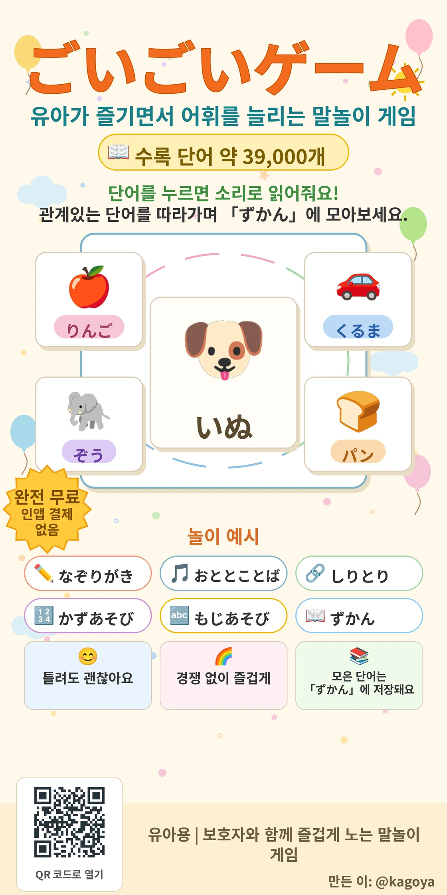

# ごいごいゲーム

**다른 언어로 읽기:** [日本語](README.md) | [やさしい日本語](README.ja-easy.md) | [English](README.en.md) | [简体中文](README.zh-Hans.md) | [繁體中文](README.zh-Hant.md) | [Português](README.pt.md) | [Español](README.es.md) | [Tiếng Việt](README.vi.md) | [ภาษาไทย](README.th.md) | **한국어** | [Français](README.fr.md) | [Deutsch](README.de.md) | [Italiano](README.it.md) | [Bahasa Indonesia](README.id.md)

유아가 즐기면서 어휘를 늘릴 수 있는, 브라우저에서 노는 말놀이 게임입니다. **완전 무료이며 과금이 없습니다.**

현재 버전: **3.6**

**▶ 플레이: https://kagoya.github.io/goigoi/**

## 노는 방법

- 시작하면 홈 화면이 열리고 놀이 카드가 나란히 표시됩니다
- 말 카드를 탭하면 음성으로 읽어 줍니다
- 「れんそう」에서는 고른 말과 관계있는 말이 주변에 나오므로, 따라가다 보면 새로운 말을 만날 수 있습니다
- 만난 말은 ずかん에 모입니다 (어떤 놀이에서 만나도 ずかん에 모입니다)

## 특징

- 수록 어휘 **약 39,000개** (ずかん은 대분류 11개, 소분류 200개의 2단계 구조)
- 홈에 나열되는 놀이는 19종류 (れんそう, ききとりクイズ, なぞりがき, おととことば, ことばたんけん, もじあそび, ごじゅうおん ならべ, しりとり, かずあそび, はんたい言葉, てびょうし, とけいあそび, おまかせコース, おきにいりだけ, おはなばたけ, 冒険マップ, おやすみ振り返り, どっちがすき？, なあに？). 초기 설정에서는 6종류 (れんそう, しりとり, もじあそび, おととことば, なぞりがき, ごじゅうおん ならべ)가 켜져 있으며, 설정에서 하나씩 켜고 끌 수 있습니다
- 「もじあそび」는 「ことば あなうめ」와 「ことば みっけ」 두 가지 놀이로 이루어져 있습니다. 「ごじゅうおん ならべ」는 독립된 놀이입니다. 오십음도에서 행을 골라 문자를 배열하고, 한 행을 완성한 뒤 문자를 선택하면 그 문자가 들어간 단어 카드가 표시됩니다
- 퀴즈에서 틀려도 실패로 하지 않고, 정답을 함께 확인하며 칭찬하는 구조입니다. 경쟁은 없습니다
- 어휘 수는 500 / 1,000 / 2,000 / 4,000 / 8,000 / 16,000 / 전부 중에서 고를 수 있습니다 (자주 쓰는 말의 8단계 등급으로 좁히며, 모든 기능에 연동됩니다)
- 말의 등급을 재검토했습니다. 일본 국립국어연구소의 교과서 코퍼스와 BCCWJ 등의 공개 데이터를 참고하여, 1,000단어 범위에 する・いる・ある 같은 기본적인 말이 들어가도록 조정했습니다
- 나이트 모드는 설정에서 "낮 / 밤 / 시간으로 자동 (18시~다음날 6시)" 중에서 고를 수 있습니다. 기기의 다크 모드와는 연동되지 않습니다
- 소리 켜기/끄기는 화면 위쪽의 공통 스위치입니다 (おととことば와 ききとりクイズ에서는 끌 수 없습니다)
- 스탬프는 전부 33종류 (컴플리트 3종류, "처음" 계열 9종류, 모은 말 수의 이정표 5종류, 달성 계열 11종류, 통산 플레이 일수 5종류). ずかん에서 여는 어린이용 「きろく」에서 둥근 스탬프 모양으로 볼 수 있습니다
- ずかん에서는 단어마다 몇 번 놀았는지가 「×N」 배지로 표시됩니다. 카드 표시에서는 5번 이상이면 은색 테두리, 10번 이상이면 금색 테두리와 👑가 붙습니다. 어린이용 「きろく」에는 많이 논 말이 「たくさん あそんだ ことば」로 나열되고, 保護者レポート와 단어 카드 인쇄에도 횟수가 들어갑니다
- ずかん은 목록 표시와 그림이 큰 카드 표시를 아이가 직접 바꿀 수 있습니다
- 읽기는 같지만 뜻이 다른 말(예: はな＝花와 鼻, たこ＝タコ와 凧)은 그림과 한자로 구별되며, ずかん에도 따로따로 모입니다
- 말의 그림은 설정 「言葉の絵を変える」에서 사진으로 바꿀 수 있습니다 (자동으로 용량을 줄여 저장하며, 백업에 포함되고, 기본값으로 되돌릴 수 있습니다)
- なぞりがき의 판정은 설정에서 획수, 획순, 방향, 모양, 정확한 모양을 개별적으로 설정할 수 있습니다 (레벨 1~5로도 선택 가능, 초기값은 레벨 4 상당)
- 설정 페이지의 설명은 14개 언어 중에서 고를 수 있습니다 (일본어, 후리가나가 붙은 쉬운 일본어, English, 중국어 간체, 중국어 번체, Português, Español, Tiếng Việt, 태국어, 한국어, 프랑스어, 독일어, 이탈리아어, 인도네시아어). 게임 안의 용어와 말은 일본어 그대로입니다
- 설정 화면에는 고른 언어의 어른용 카탈로그(PDF)를 여는 버튼도 있습니다
- 형제용 프로필은 최대 3명까지. 保護者レポート와 「きろく」, 기록 백업도 있습니다
- 「なあに？」는 그림을 보고 단어를 소리 내어 말하는 놀이입니다. 곁에서 듣고 있는 어른이 「いえたね」 버튼을 누르면 기록됩니다 (초기 설정에서는 꺼져 있습니다) 어른만 열어 볼 수 있는 정답 표시와, 판단할 때의 기준(예: 첫 소리가 맞으면 OK)도 있습니다
- 「おはなばたけ」는 모은 단어 수에 맞춰 씨앗→새싹→어린잎→꽃→나무로 자라나는 풍경입니다. 곤충도 늘어나고, 만개하면 무지개가 걸립니다
- 保護者レポート에는 단어별 「であいの深さ」(であった／えらべた／しっかり えらべた／こえに だせた) 단계별 개수와 목록도 표시됩니다 (이해를 단정하는 것이 아니라 놀이 기록에서 얻는 참고 지표입니다)
- 설정의 「集めた言葉の管理」에서는 어른이 프로필별로 모은 단어를 하나씩 확인하며 삭제할 수 있습니다 (ずかん에서는 지울 수 없습니다)

## 어른용 자료

- [어른용 카탈로그 (PDF, 일본어)](docs/goigoi-game-catalog.pdf) — 기능 목록과 설정, 이용 시 주의사항을 정리한 4페이지 자료입니다

## 동작에 대해

- 외부 서비스나 유료 AI를 쓰지 않고, 브라우저의 표준 기능만으로 동작합니다
- 논 기록은 사용 중인 브라우저 안에만 저장되며, 서버로 보내지 않습니다
- 음성 읽기와 음성 인식은 브라우저의 기능을 사용합니다 (まねっこ 발음은 Chrome / Edge에서 동작합니다. 읽어 주는 목소리의 종류는 기기에 따라 다릅니다)
- 기기에서 표시할 수 없는 이모지는 분야의 이모지로 자동 교체됩니다

## 소재에 대해

- 획순 데이터: KanjiVG © Ulrich Apel (CC BY-SA 3.0)
- 「おととことば」의 음원: CC0 음원 소재를 사용하고 있습니다. 출처는 [assets/sounds/CREDITS.md](assets/sounds/CREDITS.md)를 보세요

## 무보증

본 게임은 무보증으로 제공됩니다. 동작이나 기록의 저장을 보증하지 않으며, 이용으로 인해 생긴 문제나 손해에 대해 저작자는 책임을 지지 않습니다. 이용은 자기 책임으로 부탁드립니다.

## 라이선스

CC BY 4.0 (크리에이티브 커먼즈 저작자표시 4.0 국제 라이선스)으로 공개하고 있습니다. 저작자를 표시하면 복사, 수정, 재배포가 가능합니다. 자세한 내용은 [LICENSE](LICENSE)를 보세요. 획순 데이터 (KanjiVG)는 CC BY-SA 3.0입니다.

저작자: @kagoya
