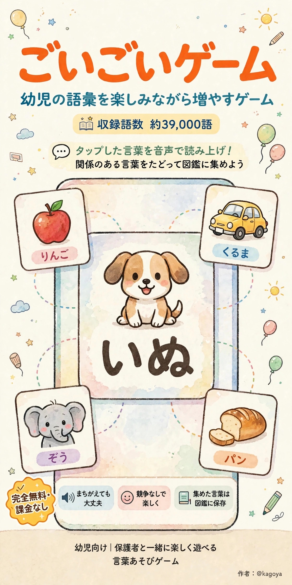

# ごいごいゲーム

幼児の語彙を楽しみながら増やす、ブラウザで遊べる言葉あそびゲームです。**完全無料・課金なし**で遊べます。

**▶ 遊ぶ： https://kagoya.github.io/goigoi/**

## 遊び方

- 言葉のカードをタップすると、音声で読み上げられます
- 選んだ言葉と関係のある言葉が周りに出てくるので、たどっていくと新しい言葉に出会えます
- 出会った言葉は図鑑にたまっていきます

## 特徴

- 収録語数 **39,451語**（図鑑は大分類11・小分類200の2階層）
- クイズで間違えても失敗にはせず、正解を一緒に確認してほめる作りです。競争はありません
- 遊びは24種類（聞き取りクイズ、ミッション、かずあそび、はんたい言葉、お話モード、えいごモード など）。大人用設定で1つずつオン・オフできます
- 語彙数は 1,000／5,000／25,000／全て から選べます（よく使う言葉の8段階レーティングで絞り込み、全機能に連動）
- きょうだい用プロフィールは最大3人まで。保護者レポートや成長アルバム、記録のバックアップもあります

## 大人向け資料

- [大人用カタログ（PDF）](docs/goigoi-game-catalog.pdf) ― 機能一覧や大人用設定、利用上の注意をまとめた4ページの資料です

## 動作について

- 外部サービスや有料のAIは使わず、ブラウザの標準機能だけで動きます
- 遊んだ記録はお使いのブラウザの中にだけ保存され、サーバーには送られません
- 音声の読み上げ・音声認識はブラウザの機能を使います（まねっこ発音は Chrome / Edge で動作します。読み上げの声の種類は端末によって異なります）

## 無保証

本ゲームは無保証で提供されます。動作や記録の保存を保証するものではなく、利用によって生じた不具合・損害について作者は責任を負いません。利用は自己責任でお願いします。

## ライセンス

CC BY 4.0（クリエイティブ・コモンズ表示 4.0 国際ライセンス）で公開しています。作者表示をすれば、複製・改変・再配布ができます。詳細は [LICENSE](LICENSE) をご覧ください。

作者： @kagoya
