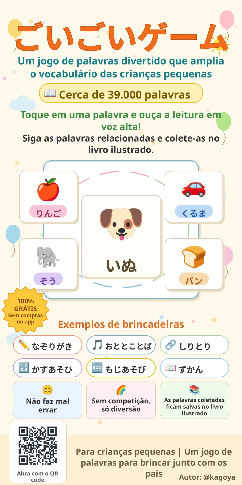

# ごいごいゲーム

**Ler em outros idiomas:** [日本語](README.md) | [やさしい日本語](README.ja-easy.md) | [English](README.en.md) | [简体中文](README.zh-Hans.md) | [繁體中文](README.zh-Hant.md) | **Português** | [Español](README.es.md) | [Tiếng Việt](README.vi.md) | [ภาษาไทย](README.th.md) | [한국어](README.ko.md) | [Français](README.fr.md) | [Deutsch](README.de.md) | [Italiano](README.it.md) | [Bahasa Indonesia](README.id.md)

Um jogo de palavras para crianças pequenas ampliarem o vocabulário brincando, jogável no navegador. **Totalmente grátis, sem cobranças.**

Versão atual: **3.6**

**▶ Jogar: https://kagoya.github.io/goigoi/**

## Como jogar

- Ao iniciar, abre-se a tela inicial, com os cartões das brincadeiras enfileirados
- Ao tocar em um cartão de palavra, a palavra é lida em voz alta
- Em 「れんそう」, as palavras relacionadas à escolhida aparecem ao redor, e seguindo-as você encontra palavras novas
- As palavras encontradas são colecionadas no ずかん (em qualquer brincadeira em que forem encontradas)

## Características

- **Cerca de 39.000 palavras** incluídas (o ずかん tem dois níveis: 11 categorias grandes e 200 categorias pequenas)
- 19 brincadeiras na tela inicial (れんそう, ききとりクイズ, なぞりがき, おととことば, ことばたんけん, もじあそび, ごじゅうおん ならべ, しりとり, かずあそび, はんたい言葉, てびょうし, とけいあそび, おまかせコース, おきにいりだけ, おはなばたけ, 冒険マップ, おやすみ振り返り, どっちがすき？, なあに？). Na configuração inicial, seis ficam ligadas (れんそう, しりとり, もじあそび, おととことば, なぞりがき, ごじゅうおん ならべ), e cada uma pode ser ligada ou desligada nas Configurações
- 「もじあそび」 é formado por dois jogos: 「ことば あなうめ」 e 「ことば みっけ」. 「ごじゅうおん ならべ」 é uma brincadeira independente: você escolhe uma linha da tabela gojuuon e organiza suas letras. Depois de completar uma linha, toque em uma letra para ver um cartão de uma palavra que contém essa letra
- Mesmo errando no quiz, isso não é tratado como fracasso: a resposta certa é conferida junto e a criança é elogiada. Não há competição
- O tamanho do vocabulário pode ser escolhido entre 500 / 1.000 / 2.000 / 4.000 / 8.000 / 16.000 / tudo (filtrado por uma classificação de 8 níveis conforme a frequência de uso; vale para todas as funções)
- A classificação das palavras foi revisada. Com referência a dados públicos, como o corpus de livros didáticos e o BCCWJ do Instituto Nacional da Língua Japonesa (NINJAL), foram feitos ajustes para que palavras básicas (como する・いる・ある) estejam incluídas na faixa de 1.000 palavras
- O modo noturno pode ser escolhido nas Configurações: "dia / noite / automático pelo horário (18h–6h)". Não segue o modo escuro do aparelho
- O interruptor de som ligado/desligado é comum, no topo da tela (não pode ser desligado em おととことば e ききとりクイズ)
- 33 tipos de carimbos no total (3 de conclusão, 9 de "primeira vez", 5 de marcos de quantidade de palavras coletadas, 11 de conquistas, 5 de dias totais de brincadeira). Podem ser vistos em formato de carimbo redondo no 「きろく」 infantil, aberto a partir do ずかん
- No ずかん, cada palavra mostra quantas vezes foi usada para brincar, em um selo "×N". Na visualização em cartões, uma palavra usada 5 vezes ou mais ganha uma borda prateada, e 10 vezes ou mais, uma borda dourada e um 👑. O 「きろく」 infantil enfileira as palavras mais brincadas como 「たくさん あそんだ ことば」, e a contagem também entra no 保護者レポート e nos cartões de palavras impressos
- O ずかん pode ser alternado pela própria criança entre a exibição em lista e a exibição em cartões com imagens grandes
- Palavras com a mesma leitura, mas significados diferentes (por exemplo, はな = 花 "flor" e 鼻 "nariz"; たこ = タコ "polvo" e 凧 "pipa") são diferenciadas pela imagem e pelo kanji, e são coletadas separadamente no ずかん
- A imagem de uma palavra pode ser trocada por uma foto em Configurações, em 「言葉の絵を変える」 (a foto é reduzida automaticamente e salva; está incluída no backup e pode voltar ao padrão)
- A avaliação do なぞりがき pode ser ajustada nas Configurações, item por item: número de traços, ordem dos traços, direção, forma e forma exata (também é possível escolher pelos níveis 1–5; o padrão equivale ao nível 4)
- As explicações da página de Configurações estão disponíveis em 14 idiomas (japonês, japonês fácil com furigana, English, chinês simplificado, chinês tradicional, Português, Español, vietnamita, tailandês, coreano, francês, alemão, italiano, indonésio). Os termos e as palavras do jogo permanecem em japonês
- A tela de Configurações também tem um botão que abre o catálogo para adultos (PDF) no idioma selecionado
- Perfis para até 3 irmãos. Há também o 保護者レポート, o 「きろく」 e backup dos registros
- 「なあに？」 é uma brincadeira em que a criança olha a imagem e diz a palavra em voz alta. Um adulto que estiver ouvindo por perto toca no botão 「いえたね」 para registrar que a palavra foi dita (vem desligada na configuração inicial) Há também uma exibição da resposta que só os adultos podem abrir e orientações para avaliar (por exemplo, vale se o primeiro som estiver certo)
- 「おはなばたけ」 é um cenário que cresce conforme a quantidade de palavras coletadas: sementes → brotos → folhas jovens → flores → árvores. Cada vez mais insetos aparecem, e um arco-íris surge na floração completa
- O 保護者レポート também mostra a "profundidade do encontro" (であいの深さ) de cada palavra em etapas — であった (conheceu) / えらべた (conseguiu escolher) / しっかり えらべた (conseguiu escolher em brincadeiras diferentes ou em dias diferentes) / こえに だせた (conseguiu dizer em voz alta) — com quantidades e listas por etapa. É apenas um guia a partir dos registros de brincadeira, não um julgamento da compreensão
- Em Configurações, 「集めた言葉の管理」 permite que um adulto apague as palavras coletadas uma a uma, com confirmação, para cada perfil (não é possível apagar a partir do ずかん)

## Material para adultos

- [Catálogo para adultos (PDF, em japonês)](docs/goigoi-game-catalog.pdf) — um documento de 4 páginas com a lista de funções, as configurações e observações sobre o uso

## Sobre o funcionamento

- Funciona usando apenas os recursos padrão do navegador, sem serviços externos nem IA paga
- Os registros de jogo são salvos apenas no seu navegador e nunca são enviados a um servidor
- A leitura em voz alta e o reconhecimento de voz usam os recursos do navegador (a pronúncia em まねっこ funciona no Chrome / Edge. Os tipos de voz disponíveis dependem do aparelho)
- Os emojis que o aparelho não consegue exibir são substituídos automaticamente pelo emoji da categoria

## Sobre os materiais usados

- Dados de ordem dos traços: KanjiVG © Ulrich Apel (CC BY-SA 3.0)
- Sons de 「おととことば」: são usados materiais de som CC0. Veja as fontes em [assets/sounds/CREDITS.md](assets/sounds/CREDITS.md)

## Sem garantia

Este jogo é fornecido sem garantia. Não há garantia de funcionamento nem do salvamento dos registros, e o autor não se responsabiliza por problemas ou danos decorrentes do uso. Use por sua própria conta e responsabilidade.

## Licença

Publicado sob CC BY 4.0 (Creative Commons Atribuição 4.0 Internacional). Com a atribuição ao autor, você pode copiar, modificar e redistribuir. Veja os detalhes em [LICENSE](LICENSE). Os dados de ordem dos traços (KanjiVG) são CC BY-SA 3.0.

Autor: @kagoya
