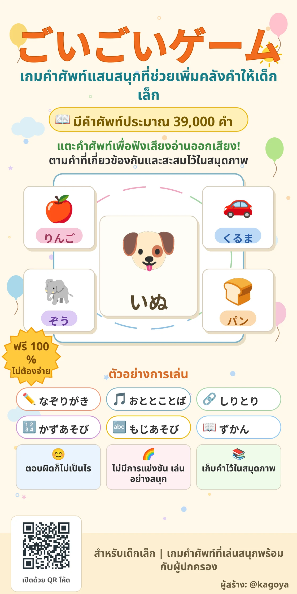

# ごいごいゲーム

**อ่านในภาษาอื่น:** [日本語](README.md) | [やさしい日本語](README.ja-easy.md) | [English](README.en.md) | [简体中文](README.zh-Hans.md) | [繁體中文](README.zh-Hant.md) | [Português](README.pt.md) | [Español](README.es.md) | [Tiếng Việt](README.vi.md) | **ภาษาไทย** | [한국어](README.ko.md) | [Français](README.fr.md) | [Deutsch](README.de.md) | [Italiano](README.it.md) | [Bahasa Indonesia](README.id.md)

เกมคำศัพท์สำหรับเด็กเล็กให้สนุกกับการเพิ่มคลังคำศัพท์ เล่นได้ในเว็บเบราว์เซอร์ **ฟรีทั้งหมด ไม่มีค่าใช้จ่าย**

เวอร์ชันปัจจุบัน: **3.4**

**▶ เล่น: https://kagoya.github.io/goigoi/**

## วิธีเล่น

- เมื่อเริ่มเกม หน้าจอหลักจะเปิดขึ้นพร้อมการ์ดของเกมต่าง ๆ เรียงกัน
- แตะการ์ดคำศัพท์ คำนั้นจะถูกอ่านออกเสียง
- ใน 「れんそう」 คำที่เกี่ยวข้องกับคำที่เลือกจะปรากฏรอบ ๆ เมื่อตามไปเรื่อย ๆ จะได้พบคำใหม่
- คำที่พบจะถูกสะสมไว้ใน ずかん (ไม่ว่าจะพบในเกมใดก็สะสมได้)

## คุณสมบัติ

- มีคำศัพท์ **ประมาณ 39,000 คำ** (ずかん มีสองระดับ: หมวดใหญ่ 11 หมวด และหมวดย่อย 200 หมวด)
- เกมบนหน้าจอหลักมี 18 เกม (れんそう, ききとりクイズ, なぞりがき, おととことば, ことばたんけん, もじあそび, ごじゅうおん ならべ, しりとり, かずあそび, はんたい言葉, てびょうし, とけいあそび, おまかせコース, おきにいりだけ, おはなばたけ, 冒険マップ, おやすみ振り返り, どっちがすき？) ในการตั้งค่าเริ่มต้นเปิดไว้ 6 เกม (れんそう, しりとり, もじあそび, おととことば, なぞりがき, ごじゅうおん ならべ) และสามารถเปิดหรือปิดทีละเกมได้ในการตั้งค่า
- 「もじあそび」 ประกอบด้วย 2 เกม คือ 「ことば あなうめ」 และ 「ことば みっけ」 ส่วน 「ごじゅうおん ならべ」 เป็นเกมแยกต่างหาก: เลือกแถวจากตารางห้าสิบเสียง (gojuuon) แล้วเรียงตัวอักษรของแถวนั้น เมื่อเรียงครบหนึ่งแถว แตะตัวอักษรหนึ่งตัวเพื่อดูการ์ดคำศัพท์ที่มีตัวอักษรนั้นอยู่
- แม้ตอบคำถามผิดก็ไม่ถือว่าล้มเหลว จะตรวจสอบคำตอบที่ถูกต้องไปด้วยกันและชมเชย ไม่มีการแข่งขัน
- จำนวนคำศัพท์เลือกได้จาก 1,000 / 5,000 / 25,000 / ทั้งหมด (กรองตามระดับความนิยม 8 ระดับ และใช้กับทุกฟังก์ชัน)
- มีการทบทวนการจัดระดับคำศัพท์ โดยอ้างอิงข้อมูลสาธารณะ เช่น คลังข้อมูลหนังสือเรียนและ BCCWJ ของสถาบันภาษาญี่ปุ่นแห่งชาติ (NINJAL) และปรับให้คำพื้นฐาน (เช่น する・いる・ある) อยู่ในขอบเขต 1,000 คำ
- โหมดกลางคืนเลือกได้ในการตั้งค่า: "กลางวัน / กลางคืน / อัตโนมัติตามเวลา (18:00–6:00)" ไม่เชื่อมโยงกับโหมดมืดของอุปกรณ์
- สวิตช์เปิด/ปิดเสียงเป็นสวิตช์ร่วมที่ด้านบนของหน้าจอ (ปิดไม่ได้ใน おととことば และ ききとりクイズ)
- ตราประทับมีทั้งหมด 33 ชนิด (ชนิดสำเร็จครบ 3 ชนิด, ชนิด "ครั้งแรก" 9 ชนิด, ชนิดเป้าหมายจำนวนคำที่สะสม 5 ชนิด, ชนิดความสำเร็จ 11 ชนิด, ชนิดจำนวนวันที่เล่นรวมทั้งหมด 5 ชนิด) ดูได้ในรูปแบบตราประทับทรงกลมใน 「きろく」 สำหรับเด็ก ซึ่งเปิดจาก ずかん
- ใน ずかん แต่ละคำจะแสดงจำนวนครั้งที่เคยเล่นด้วยเป็นป้าย "×N" ในการแสดงแบบการ์ด คำที่เล่น 5 ครั้งขึ้นไปจะมีขอบสีเงิน และ 10 ครั้งขึ้นไปจะมีขอบสีทองและ 👑 ส่วน 「きろく」 สำหรับเด็กจะเรียงคำที่เล่นบ่อยที่สุดไว้เป็น 「たくさん あそんだ ことば」 และจำนวนครั้งยังอยู่ใน 保護者レポート และการ์ดคำศัพท์ที่พิมพ์ออกมาด้วย
- ずかん สามารถสลับระหว่างการแสดงแบบรายการกับการแสดงแบบการ์ดที่มีรูปใหญ่ได้ โดยเด็กเป็นผู้สลับเอง
- คำที่อ่านเหมือนกันแต่มีความหมายต่างกัน (เช่น はな = 花 "ดอกไม้" กับ 鼻 "จมูก"; たこ = タコ "ปลาหมึก" กับ 凧 "ว่าว") จะแยกแยะด้วยรูปภาพและตัวคันจิ และสะสมแยกกันใน ずかん
- รูปของคำศัพท์สามารถเปลี่ยนเป็นภาพถ่ายได้ในการตั้งค่า ที่ 「言葉の絵を変える」 (ภาพจะถูกย่อขนาดโดยอัตโนมัติและบันทึกไว้ รวมอยู่ในการสำรองข้อมูล และคืนค่าเริ่มต้นได้)
- การตรวจ なぞりがき สามารถตั้งค่าแยกแต่ละรายการได้ในการตั้งค่า: จำนวนเส้น, ลำดับเส้น, ทิศทาง, รูปร่าง และรูปร่างที่แม่นยำ (เลือกตามระดับ 1–5 ก็ได้ ค่าเริ่มต้นเทียบเท่าระดับ 4)
- คำอธิบายในหน้าการตั้งค่ามีให้เลือก 14 ภาษา (ภาษาญี่ปุ่น, ภาษาญี่ปุ่นแบบง่ายพร้อมฟูริงานะ, English, จีนตัวย่อ, จีนตัวเต็ม, Português, Español, Tiếng Việt, ภาษาไทย, เกาหลี, ฝรั่งเศส, เยอรมัน, อิตาลี, อินโดนีเซีย) คำศัพท์และคำในเกมยังคงเป็นภาษาญี่ปุ่น
- โปรไฟล์สำหรับพี่น้องได้สูงสุด 3 คน นอกจากนี้ยังมี 保護者レポート, 「きろく」 และการสำรองข้อมูลบันทึก

## เอกสารสำหรับผู้ใหญ่

- [แคตตาล็อกสำหรับผู้ใหญ่ (PDF, ภาษาญี่ปุ่น)](docs/goigoi-game-catalog.pdf) — เอกสาร 4 หน้าที่รวบรวมรายการฟังก์ชัน การตั้งค่า และข้อควรทราบในการใช้งาน

## เกี่ยวกับการทำงาน

- ทำงานโดยใช้เพียงฟังก์ชันมาตรฐานของเบราว์เซอร์ ไม่ใช้บริการภายนอกหรือ AI แบบเสียเงิน
- บันทึกการเล่นจะถูกเก็บไว้ในเบราว์เซอร์ของคุณเท่านั้น และไม่ถูกส่งไปยังเซิร์ฟเวอร์
- การอ่านออกเสียงและการรู้จำเสียงใช้ฟังก์ชันของเบราว์เซอร์ (การออกเสียงใน まねっこ ใช้ได้ใน Chrome / Edge ชนิดของเสียงที่มีให้ใช้ขึ้นอยู่กับอุปกรณ์)
- อีโมจิที่อุปกรณ์แสดงไม่ได้จะถูกแทนที่ด้วยอีโมจิของหมวดนั้นโดยอัตโนมัติ

## เกี่ยวกับสื่อที่ใช้

- ข้อมูลลำดับเส้นเขียน: KanjiVG © Ulrich Apel (CC BY-SA 3.0)
- เสียงของ 「おととことば」: ใช้สื่อเสียง CC0 ดูแหล่งที่มาได้ที่ [assets/sounds/CREDITS.md](assets/sounds/CREDITS.md)

## ไม่มีการรับประกัน

เกมนี้ให้ใช้โดยไม่มีการรับประกัน ไม่รับประกันการทำงานหรือการบันทึกข้อมูล และผู้สร้างไม่รับผิดชอบต่อปัญหาหรือความเสียหายที่เกิดจากการใช้งาน โปรดใช้ด้วยความรับผิดชอบของตนเอง

## สัญญาอนุญาต

เผยแพร่ภายใต้ CC BY 4.0 (Creative Commons แสดงที่มา 4.0 สากล) เมื่อระบุที่มาของผู้สร้าง สามารถคัดลอก ดัดแปลง และแจกจ่ายต่อได้ ดูรายละเอียดที่ [LICENSE](LICENSE) ส่วนข้อมูลลำดับเส้นเขียน (KanjiVG) เป็น CC BY-SA 3.0

ผู้สร้าง: @kagoya
