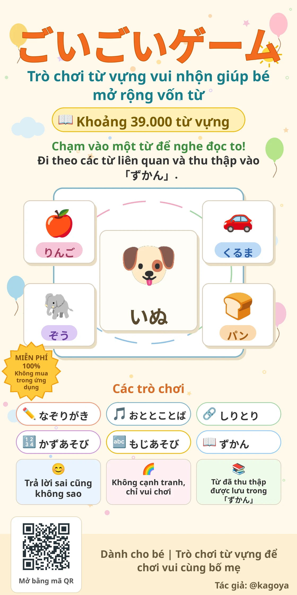

# ごいごいゲーム

**Đọc bằng ngôn ngữ khác:** [日本語](README.md) | [やさしい日本語](README.ja-easy.md) | [English](README.en.md) | [简体中文](README.zh-Hans.md) | [繁體中文](README.zh-Hant.md) | [Português](README.pt.md) | [Español](README.es.md) | **Tiếng Việt** | [ภาษาไทย](README.th.md) | [한국어](README.ko.md) | [Français](README.fr.md) | [Deutsch](README.de.md) | [Italiano](README.it.md) | [Bahasa Indonesia](README.id.md)

Một trò chơi từ vựng để trẻ nhỏ vừa chơi vừa mở rộng vốn từ, chơi được trên trình duyệt. **Hoàn toàn miễn phí, không thu phí.**

Phiên bản hiện tại: **3.2**

**▶ Chơi: https://kagoya.github.io/goigoi/**

## Cách chơi

- Khi bắt đầu, màn hình chính sẽ mở ra với các thẻ trò chơi xếp thành hàng
- Chạm vào thẻ từ, từ đó sẽ được đọc to lên
- Trong 「れんそう」, các từ liên quan đến từ đã chọn sẽ xuất hiện xung quanh, đi theo chúng bạn sẽ gặp những từ mới
- Những từ gặp được sẽ được sưu tầm vào ずかん (dù gặp ở trò chơi nào cũng được sưu tầm)

## Đặc điểm

- Thu thập **khoảng 39.000 từ** (ずかん có hai cấp: 11 phân loại lớn và 200 phân loại nhỏ)
- 18 trò chơi trên màn hình chính (れんそう, ききとりクイズ, なぞりがき, おととことば, ことばたんけん, もじあそび, ごじゅうおん ならべ, しりとり, かずあそび, はんたい言葉, てびょうし, とけいあそび, おまかせコース, おきにいりだけ, おはなばたけ, 冒険マップ, おやすみ振り返り, どっちがすき？). Trong cài đặt ban đầu có 6 trò chơi được bật (れんそう, しりとり, もじあそび, おととことば, なぞりがき, ごじゅうおん ならべ), và có thể bật hoặc tắt từng trò chơi trong Cài đặt
- 「もじあそび」 gồm hai trò chơi: 「ことば あなうめ」 và 「ことば みっけ」. 「ごじゅうおん ならべ」 là một trò chơi riêng: chọn một hàng trong bảng gojuuon và sắp xếp các chữ của hàng đó. Sau khi xếp xong một hàng, chạm vào một chữ để xem thẻ một từ có chứa chữ đó
- Dù trả lời sai câu đố cũng không bị coi là thất bại: đáp án đúng sẽ được cùng nhau kiểm tra và trẻ sẽ được khen. Không có thi đua
- Số lượng từ vựng có thể chọn từ 1.000 / 5.000 / 25.000 / tất cả (lọc theo thang đánh giá 8 mức về độ thường dùng; áp dụng cho mọi tính năng)
- Chế độ ban đêm có thể chọn trong Cài đặt: "ban ngày / ban đêm / tự động theo giờ (18 giờ–6 giờ)". Không liên động với chế độ tối của thiết bị
- Công tắc bật/tắt âm thanh là công tắc chung ở phía trên màn hình (không thể tắt trong おととことば và ききとりクイズ)
- Tổng cộng 33 loại con dấu (3 loại hoàn thành, 9 loại "lần đầu tiên", 5 loại mốc số từ đã sưu tầm, 11 loại thành tích, 5 loại tổng số ngày đã chơi). Có thể xem dưới dạng con dấu tròn trong 「きろく」 dành cho trẻ em, mở từ ずかん
- Trong ずかん, mỗi từ hiển thị số lần đã chơi với từ đó bằng huy hiệu "×N". Ở chế độ thẻ, từ được chơi 5 lần trở lên có viền bạc, 10 lần trở lên có viền vàng và 👑. 「きろく」 dành cho trẻ em xếp các từ được chơi nhiều nhất thành 「たくさん あそんだ ことば」, và số lần cũng có trong 保護者レポート và thẻ từ in ra
- ずかん có thể chuyển đổi giữa hiển thị dạng danh sách và hiển thị dạng thẻ với hình ảnh lớn, do chính trẻ thao tác
- Hình ảnh của một từ có thể đổi thành ảnh chụp trong Cài đặt, tại 「言葉の絵を変える」 (ảnh được tự động thu nhỏ dung lượng và lưu lại; được bao gồm trong bản sao lưu và có thể khôi phục về mặc định)
- Việc chấm なぞりがき có thể cài đặt từng mục trong Cài đặt: số nét, thứ tự nét, hướng, hình dạng và hình dạng chính xác (cũng có thể chọn theo cấp độ 1–5; mặc định tương đương cấp độ 4)
- Phần giải thích trên trang Cài đặt có 14 ngôn ngữ (tiếng Nhật, tiếng Nhật dễ hiểu kèm furigana, English, tiếng Trung giản thể, tiếng Trung phồn thể, Português, Español, Tiếng Việt, tiếng Thái, tiếng Hàn, tiếng Pháp, tiếng Đức, tiếng Ý, tiếng Indonesia). Các thuật ngữ và từ vựng trong trò chơi vẫn giữ nguyên tiếng Nhật
- Hồ sơ cho tối đa 3 anh chị em. Ngoài ra còn có 保護者レポート, 「きろく」 và sao lưu bản ghi

## Tài liệu cho người lớn

- [Danh mục cho người lớn (PDF, tiếng Nhật)](docs/goigoi-game-catalog.pdf) — tài liệu 4 trang tổng hợp danh sách tính năng, cài đặt và lưu ý khi sử dụng

## Về cách hoạt động

- Hoạt động chỉ bằng các tính năng tiêu chuẩn của trình duyệt, không dùng dịch vụ bên ngoài hay AI trả phí
- Bản ghi chơi chỉ được lưu trong trình duyệt của bạn và không bao giờ được gửi đến máy chủ
- Đọc to và nhận dạng giọng nói sử dụng tính năng của trình duyệt (phát âm trong まねっこ hoạt động trên Chrome / Edge. Loại giọng đọc có sẵn tùy thuộc vào thiết bị)
- Biểu tượng cảm xúc mà thiết bị không hiển thị được sẽ tự động được thay bằng biểu tượng của phân loại đó

## Về tư liệu sử dụng

- Dữ liệu thứ tự nét viết: KanjiVG © Ulrich Apel (CC BY-SA 3.0)
- Âm thanh của 「おととことば」: sử dụng tư liệu âm thanh CC0. Xem nguồn tại [assets/sounds/CREDITS.md](assets/sounds/CREDITS.md)

## Không bảo đảm

Trò chơi này được cung cấp mà không có bảo đảm. Không bảo đảm về hoạt động hay việc lưu bản ghi, và tác giả không chịu trách nhiệm về mọi vấn đề hay thiệt hại phát sinh do việc sử dụng. Vui lòng tự chịu trách nhiệm khi sử dụng.

## Giấy phép

Phát hành theo CC BY 4.0 (Creative Commons Ghi công 4.0 Quốc tế). Khi ghi công tác giả, bạn có thể sao chép, sửa đổi và phân phối lại. Xem chi tiết tại [LICENSE](LICENSE). Dữ liệu thứ tự nét viết (KanjiVG) là CC BY-SA 3.0.

Tác giả: @kagoya
