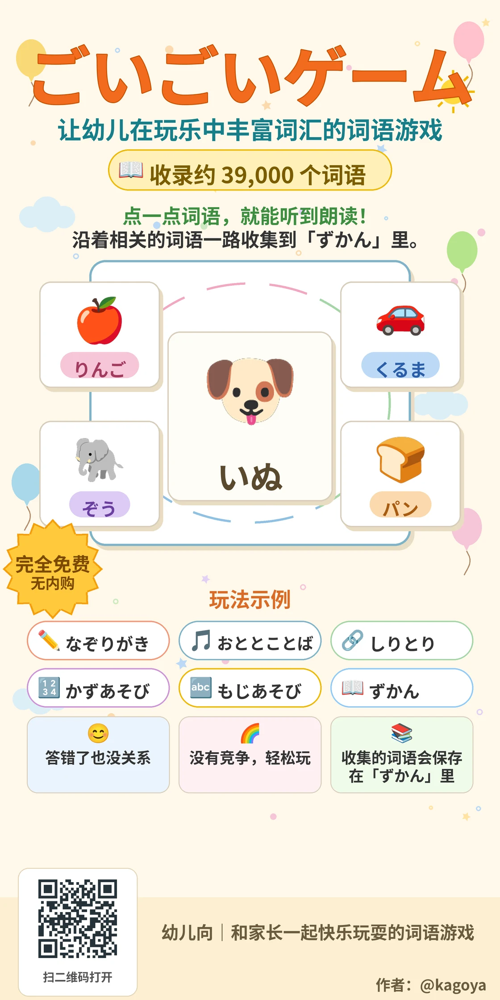

# ごいごいゲーム

**其他语言：** [日本語](README.md) | [やさしい日本語](README.ja-easy.md) | [English](README.en.md) | **简体中文** | [繁體中文](README.zh-Hant.md) | [Português](README.pt.md) | [Español](README.es.md) | [Tiếng Việt](README.vi.md) | [ภาษาไทย](README.th.md) | [한국어](README.ko.md) | [Français](README.fr.md) | [Deutsch](README.de.md) | [Italiano](README.it.md) | [Bahasa Indonesia](README.id.md)

这是一款在浏览器中游玩的词语游戏，让幼儿在玩乐中丰富词汇量。**完全免费，无任何收费。**

当前版本：**3.6**

**▶ 开始玩：https://kagoya.github.io/goigoi/**

## 玩法

- 启动后会打开主屏幕，上面排列着各种玩法的卡片
- 点按词语卡片，就会用语音朗读该词语
- 在「れんそう」中，所选词语的相关词语会出现在周围，顺着点下去就能遇到新词语
- 遇到的词语会收集到ずかん中（无论在哪种玩法中遇到，都会收集到ずかん）

## 特点

- 收录词语 **约39,000个**（ずかん分为两个层级：11个大分类、200个小分类）
- 主屏幕上有19种玩法（れんそう、ききとりクイズ、なぞりがき、おととことば、ことばたんけん、もじあそび、ごじゅうおん ならべ、しりとり、かずあそび、はんたい言葉、てびょうし、とけいあそび、おまかせコース、おきにいりだけ、おはなばたけ、冒険マップ、おやすみ振り返り、どっちがすき？、なあに？）。初始设置中开启6种（れんそう、しりとり、もじあそび、おととことば、なぞりがき、ごじゅうおん ならべ），可以在设置中逐个开启或关闭
- 「もじあそび」由两个游戏组成：「ことば あなうめ」和「ことば みっけ」。「ごじゅうおん ならべ」是独立的玩法：从五十音图中选择一行，排列该行的文字。一行排齐后，点选其中的一个文字，就会显示包含该文字的单词卡
- 即使答错问答题也不会算作失败，而是会一起确认正确答案并给予表扬。没有竞争
- 词汇量可以从 500／1,000／2,000／4,000／8,000／16,000／全部 中选择（按使用频率的8级评级筛选，与所有功能联动）
- 词语评级已经重新调整。参考国立国语研究所的教科书语料库和BCCWJ等公开数据进行了调整，使1,000词的范围内包含する・いる・ある等基本词语
- 夜间模式可以在设置中从「白天／夜晚／按时间自动（18点〜次日6点）」中选择。不会跟随设备的深色模式
- 声音的开／关是屏幕顶部的通用开关（在おととことば和ききとりクイズ中无法关闭）
- 印章共33种（完成类3种、「第一次」类9种、收集数量里程碑5种、成就类11种、累计游玩天数5种）。可以在从ずかん打开的儿童用「きろく」中，以圆形印章的形式查看
- 在ずかん中，每个单词都会以「×N」徽章显示玩过的次数。在卡片视图中，玩过5次以上的单词会加上银色边框，10次以上会加上金色边框和👑。儿童用「きろく」中会列出玩得最多的「たくさん あそんだ ことば」，保護者レポート和单词卡的打印中也会包含次数
- ずかん可以在列表显示和图片较大的卡片显示之间切换，由孩子自己操作
- 读音相同但意义不同的词语（例如 はな＝花与鼻、たこ＝章鱼与风筝），通过图片和汉字进行区分，在ずかん中也会分别收集
- 词语的图片可以在设置「言葉の絵を変える」中换成照片（自动压缩轻量化后保存，支持备份，可恢复为默认）
- なぞりがき的判定可以在设置中分别设置笔画数、笔顺、方向、形状、精确形状（也可以按等级1〜5选择，初始值为相当于等级4的设置）
- 设置页面的说明提供14种语言（日语、やさしい日本語（带注音假名）、English、简体中文、繁體中文、Português、Español、Tiếng Việt、ภาษาไทย、한국어、Français、Deutsch、Italiano、Bahasa Indonesia）。游戏内的用语和词语保持日语
- 设置画面中还有一个按钮，可以打开所选语言的成人用目录（PDF）
- 最多可创建3个孩子用的个人档案。还有保護者レポート、「きろく」以及记录备份功能
- 「なあに？」是看着图片把词语说出声的玩法。在旁边听的大人点击「いえたね」按钮即可记录（初始设置为关闭） 还有仅供大人查看的答案显示，以及判断参考（例如第一个音对上即可）
- 「おはなばたけ」是随着收集词语数量而成长的景色：种子→嫩芽→嫩叶→花朵→树木，昆虫也会越来越多，盛开时还会出现彩虹
- 保護者レポート中还会显示每个词语的「であいの深さ」阶段（であった／えらべた／しっかり えらべた／こえに だせた）的数量和列表（这只是根据游玩记录得出的参考，并不是对理解程度的断定）
- 在设置的「集めた言葉の管理」中，大人可以按个人档案逐个确认并删除已收集的词语（无法从ずかん中删除）

## 给大人的资料

- [成人用目录（PDF，日语）](docs/goigoi-game-catalog.pdf) ― 汇总了功能一览、设置和使用注意事项的4页资料

## 关于运行

- 不使用外部服务或付费AI，仅使用浏览器的标准功能运行
- 游玩记录只保存在您使用的浏览器中，不会发送到服务器
- 语音朗读和语音识别使用浏览器的功能（まねっこ发音在 Chrome / Edge 中可用。可用声音的种类因设备而异）
- 设备无法显示的表情符号，会自动替换为该分类的表情符号

## 关于素材

- 笔顺数据：KanjiVG © Ulrich Apel（CC BY-SA 3.0）
- 「おととことば」的音源：使用 CC0 音频素材。出处请参见 [assets/sounds/CREDITS.md](assets/sounds/CREDITS.md)

## 无担保

本游戏按无担保方式提供。不保证其运行或记录的保存，对于因使用而产生的问题或损害，作者不承担责任。使用请自行负责。

## 许可证

以 CC BY 4.0（知识共享署名 4.0 国际许可协议）发布。注明作者即可复制、修改和再分发。详情请参见 [LICENSE](LICENSE)。笔顺数据（KanjiVG）为 CC BY-SA 3.0。

作者：@kagoya
