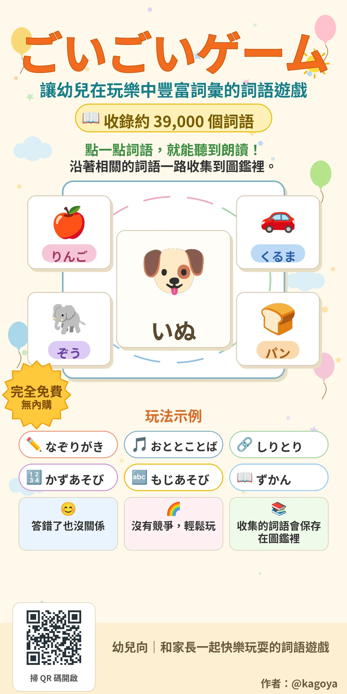

# ごいごいゲーム

**其他語言：** [日本語](README.md) | [やさしい日本語](README.ja-easy.md) | [English](README.en.md) | [简体中文](README.zh-Hans.md) | **繁體中文** | [Português](README.pt.md) | [Español](README.es.md) | [Tiếng Việt](README.vi.md) | [ภาษาไทย](README.th.md) | [한국어](README.ko.md) | [Français](README.fr.md) | [Deutsch](README.de.md) | [Italiano](README.it.md) | [Bahasa Indonesia](README.id.md)

這是一款在瀏覽器中遊玩的詞語遊戲，讓幼兒在玩樂中豐富詞彙量。**完全免費，無任何收費。**

目前版本：**3.1**

**▶ 開始玩：https://kagoya.github.io/goigoi/**

## 玩法

- 啟動後會開啟主畫面，上面排列著各種玩法的卡片
- 點按詞語卡片，就會用語音朗讀該詞語
- 在「れんそう」中，所選詞語的相關詞語會出現在周圍，順著點下去就能遇到新詞語
- 遇到的詞語會收集到ずかん中（無論在哪種玩法中遇到，都會收集到ずかん）

## 特點

- 收錄詞語 **約39,000個**（ずかん分為兩個層級：11個大分類、200個小分類）
- 主畫面上有18種玩法（れんそう、ききとりクイズ、なぞりがき、おととことば、ことばたんけん、もじあそび、五十音ならべ、しりとり、かずあそび、はんたい言葉、てびょうし、とけいあそび、おまかせコース、おきにいりだけ、おはなばたけ、冒険マップ、おやすみ振り返り、どっちがすき？）。初始設定中開啟6種（れんそう、しりとり、もじあそび、おととことば、なぞりがき、五十音ならべ），可以在設定中逐個開啟或關閉
- 「もじあそび」由兩個遊戲組成：「ことば あなうめ」和「ことば みっけ」。「五十音ならべ」是獨立的玩法：從五十音圖中選擇一行，排列該行的文字。一行排齊後，點選其中一個文字，就會顯示包含該文字的單詞卡
- 即使答錯問答題也不會算作失敗，而是會一起確認正確答案並給予表揚。沒有競爭
- 詞彙量可以從 1,000／5,000／25,000／全部 中選擇（按使用頻率的8級評級篩選，與所有功能連動）
- 夜間模式可以在設定中從「白天／夜晚／按時間自動（18點〜次日6點）」中選擇。不會跟隨裝置的深色模式
- 聲音的開／關是畫面頂部的通用開關（在おととことば和ききとりクイズ中無法關閉）
- 印章共25種（完成類3種、「第一次」類8種、收集數量里程碑5種、成就類9種）。可以在從ずかん開啟的兒童用「きろく」中，以圓形印章的形式查看
- ずかん可以在列表顯示和圖片較大的卡片顯示之間切換，由孩子自己操作
- 詞語的圖片可以在設定「言葉の絵を変える」中換成照片（自動壓縮輕量化後儲存，支援備份，可恢復為預設）
- なぞりがき的判定可以在設定中分別設定筆畫數、筆順、方向、形狀、精確形狀（也可以按等級1〜5選擇，初始值為相當於等級4的設定）
- 設定頁面的說明提供14種語言（日語、やさしい日本語（帶注音假名）、English、简体中文、繁體中文、Português、Español、Tiếng Việt、ภาษาไทย、한국어、Français、Deutsch、Italiano、Bahasa Indonesia）。遊戲內的用語和詞語保持日語
- 最多可建立3個孩子用的個人檔案。還有保護者レポート、「きろく」以及記錄備份功能

## 給大人的資料

- [成人用目錄（PDF，日語）](docs/goigoi-game-catalog.pdf) ― 彙總了功能一覽、設定和使用注意事項的4頁資料

## 關於運作

- 不使用外部服務或付費AI，僅使用瀏覽器的標準功能運作
- 遊玩記錄只儲存在您使用的瀏覽器中，不會傳送到伺服器
- 語音朗讀和語音辨識使用瀏覽器的功能（まねっこ發音在 Chrome / Edge 中可用。可用聲音的種類因裝置而異）
- 裝置無法顯示的表情符號，會自動替換為該分類的表情符號

## 關於素材

- 筆順資料：KanjiVG © Ulrich Apel（CC BY-SA 3.0）
- 「おととことば」的音源：使用 CC0 音訊素材。出處請參見 [assets/sounds/CREDITS.md](assets/sounds/CREDITS.md)

## 無擔保

本遊戲按無擔保方式提供。不保證其運作或記錄的儲存，對於因使用而產生的問題或損害，作者不承擔責任。使用請自行負責。

## 授權

以 CC BY 4.0（創用CC 姓名標示 4.0 國際授權條款）發布。註明作者即可複製、修改和再散布。詳情請參見 [LICENSE](LICENSE)。筆順資料（KanjiVG）為 CC BY-SA 3.0。

作者：@kagoya
